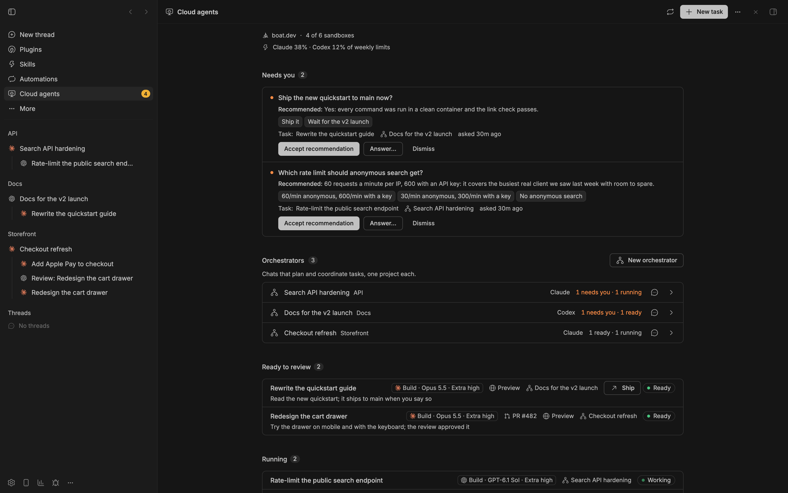
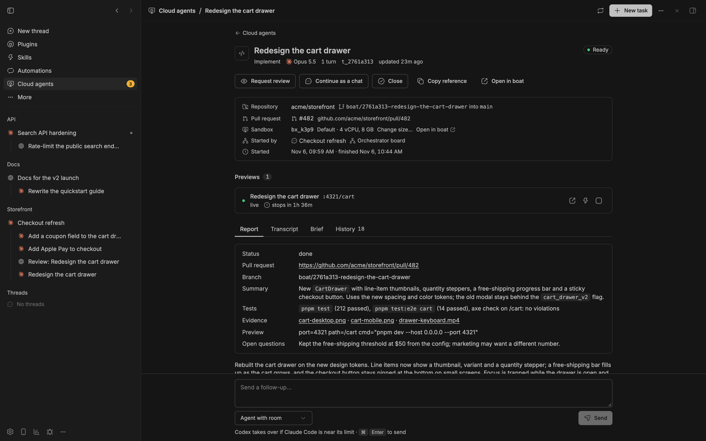
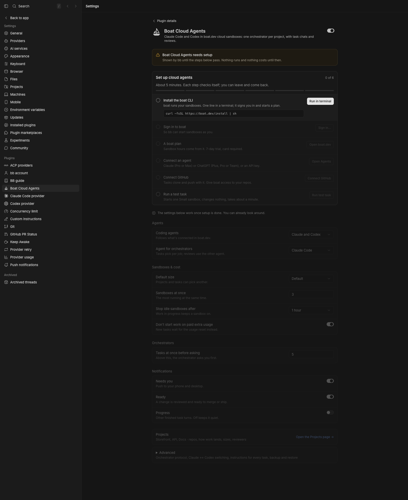

# Boat Cloud Agents for bb

Run Claude Code and Codex in [boat.dev](https://boat.dev) cloud sandboxes
from [bb](https://getbb.app). Ask any chat to send a task to the cloud,
follow it on the Cloud agents page, and review the pull request. For a
steady stream of related work, an orchestrator chat can plan it, start the
tasks and get each change reviewed.

This is a community plugin. It is not made by or affiliated with boat.dev or
bb. The workflow is inspired by Conductor's cloud workflow.

A short demo with demo data (the chat replies are scripted):

https://github.com/user-attachments/assets/769a7fcc-e995-48c4-b4fa-097ea47a7b97





## Getting started

You need bb 0.48 or later, a boat.dev account with a plan, and a Claude or
ChatGPT subscription. The steps below set up the rest.

1. **Install boat** on the machine that runs bb:
   ```sh
   curl -fsSL https://boat.dev/install | sh
   ```
   It signs you in and starts a plan (7-day trial, card required). When it
   asks who the sandboxes are for, answer **just me**. The other answer
   turns on "Safe for third parties", and agents then get no logins.
   Already have boat? `boat onboard` signs you in and finishes whatever your
   account still needs; it's safe to run again.
2. **Connect an agent** on boat.dev → [Agents](https://boat.dev/dashboard?tab=agents):
   sign in with Claude (Pro or Max) and/or ChatGPT (Plus, Pro or Team), or
   add an API key. Tasks use these subscriptions.
3. **Connect GitHub** on [boat.dev](https://boat.dev/dashboard) →
   Environment → Connect GitHub, and give boat access to your repos. Tasks
   clone and push with it.
4. **Install the plugin:**
   ```sh
   # Follows the default branch
   bb plugin install https://github.com/scheinriese/bb-plugin-boat

   # Or follows 0.1.x release tags (the marketplace listing follows every 0.x release)
   bb plugin install git:https://github.com/scheinriese/bb-plugin-boat.git@^0.1.0
   ```
   bb shows what it will install and asks you to confirm. A plugin is
   full-trust code, so read [what it runs, reaches and stores](SECURITY.md)
   first.
5. **Check the setup.** Open **Cloud agents** in bb's sidebar. Until
   everything is in place, it shows a "Set up cloud agents" checklist with a
   fix for each problem (**Sign in…** opens a terminal that runs
   `boat onboard`; other commands have **Run in terminal**). Or run:
   ```sh
   bb boat doctor
   ```
   It checks the boat CLI, your sign-in, plan, agent logins, boat
   environment and bb Connect, without starting a sandbox. GitHub access
   can only be seen from inside a sandbox, so it shows your last task's
   check (your first task on a repo checks it).

   
6. **Run a test task.** Click **Run a test task** on the page, or run
   `bb boat task start --test`. It needs no repo and changes nothing: the
   agent reports the sandbox's OS, Node and git versions and whether GitHub
   access works. That proves your sign-in, plan and agent login, for one
   sandbox start and a minute or two of a Small sandbox.
7. **Real work.** Ask any chat, for example: "Use a cloud agent to fix the
   flaky login test in acme/web." Or click **New task**, pick the repo and
   say what to do. The agent works on its own branch and opens a draft pull
   request, and the chat that started it hears back when it's done.

There's nothing to set first: **Coding agents** follows what's connected in
boat.dev, and tasks run headless in boat. Once you work on the same repos
often, add them as [projects](docs/features.md#projects).

## Three ways to use it

| | Task from a chat | Cloud agents page | Boat sandbox chat |
| --- | --- | --- | --- |
| How you start it | Ask any chat to use a cloud agent, or **Send to a cloud agent** in the send menu | **New task** (also **Start a cloud task** on bb's New thread screen) | Pick **Boat sandbox** in a new chat's environment menu |
| Where the agent runs | In its own boat sandbox | In its own boat sandbox | The whole chat runs in a boat sandbox |
| Where you follow it | The chat hears back when a turn ends; the details are on the Cloud agents page | On the Cloud agents page: transcript, report, pull request, preview | In the chat, like any other |
| Can you type into it | Through the chat that started it, or the task's reply box | The task's reply box | Yes, it's a regular chat |
| Needs bb Connect | No (only for task chats) | No (only for task chats) | Yes |
| Best for | Handing off a piece of work without leaving your conversation | Starting work directly, checking a repo, a test task | Long hands-on sessions that keep going while this computer sleeps |

A **task chat** is a task you can open as a bb chat and type into: set
**How tasks run** to one of the "As chats" options (needs bb Connect), tick
**Run as a chat** in New task, or use **Continue as a chat** on a headless
task's page. See
[How tasks run](docs/features.md#how-tasks-run-in-boat-or-as-task-chats). Turn on bb Connect
with `bb account login` (then `bb connect on` if it's off); the setup
checklist shows its state.

For a goal that keeps producing tasks, an **orchestrator** (a chat that plans
and coordinates tasks for one project) does the planning, starting and
reviewing for you. See [Go further](#go-further-orchestrators).

## Costs

The plugin adds no service of its own. Each task uses two things you already
pay for:

- **Sandbox time on your boat.dev plan.** Small sandboxes run at half rate,
  Large at double; XLarge needs boat's $100 plan or higher. boat's $20 plan
  includes about 555 hours of Default sandbox time a month (about $0.036 an
  hour). A stopped sandbox uses no sandbox time, and waking it counts as a
  start. The trial lasts 7 days (card required) and allows 2 sandboxes at
  once, Small and Default sizes, 75 starts a day and an auto-stop of at
  most 2 hours. The plugin reads that cap from `boat limits` and keeps
  every sandbox it starts, resumes or extends within it. `boat limits`
  shows what's left.
- **Agent usage on your Claude or ChatGPT subscription**, from the same
  usage limits you use everywhere else.

What the plugin does to keep that down:

- At most 3 sandboxes run at once (**Sandboxes at once**; 0 means your
  plan's limit). Agents using the plugin ask you before they start more
  than 3 tasks at once.
- New sandboxes use the **Default sandbox size** (Default) unless a
  project or a task picks another. Agents need your OK for a larger
  sandbox, except one size up after it ran out of memory or came close
  ([sandbox sizes](docs/features.md#sandbox-sizes-and-memory)).
- A sandbox stops once its agent has waited 30 minutes (**Stop idle
  sandboxes after**). The task picks up again on your next message. Closing
  a task deletes its sandbox.
- When your agents are near their usage limits, new tasks wait for a reset
  instead of starting on paid extra usage (**Don't start work on paid extra
  usage**).
- It never turns on boat's paid extra starts (`boat billing extra-starts`,
  off by default).

An orchestrator uses sandbox hours and agent usage faster than single tasks:
it starts several tasks, and a review for each.

## What a task can reach

The agent runs every command without asking, inside its sandbox. It can use
what your boat environment gives it: push access to its GitHub repos, your
Claude or ChatGPT login, its variables and secret files. A hostile README or
issue could try to talk it into sending those somewhere, so keep secrets out
of environments you use for repos you don't trust.

- Tasks never push to protected branches (`main`, `master`, base branches
  and the ones you add). A git hook enforces it, but it's a guard for
  well-behaved agents, not a security boundary: protect your base branches
  on GitHub too.
- Task chats and cloud orchestrators also run bb in their sandbox, with this
  bb machine's credentials, connected through bb Connect. Use them only for
  repos you trust. **How tasks run** → "As chats for projects" allows task
  chats only in projects that have **Run tasks as chats** on. **Run as a
  chat** and **Continue as a chat** warn you before they make a chat for
  any other repo.
- boat's AI credentials proxy (`boat ai proxy on`, a paid boat add-on:
  `boat ai proxy` shows the price) gives sandboxes placeholder keys, so your
  real Claude and ChatGPT credentials never enter them.

More in [SECURITY.md](SECURITY.md): what the plugin runs, what it can reach
and what it stores.

## Features at a glance

- [**The Cloud agents page**](docs/features.md#the-cloud-agents-page): a
  setup checklist until everything works, then work ready to review, running
  tasks, previews and sandboxes. Each task has a page with its report,
  review, transcript and a reply box.
- [**Start from anywhere**](docs/features.md#start-from-anywhere-in-bb): any
  chat, the send menu, bb's New thread screen, or a whole chat on a Boat
  sandbox.
- [**New task**](docs/features.md#new-task) with starters: check a repo runs
  in a sandbox, fix a bug, explore and plan.
- [**Projects**](docs/features.md#projects): repos with their base branches,
  boat environment, snapshot, sandbox size and instructions, set once.
- [**Task chats**](docs/features.md#how-tasks-run-in-boat-or-as-task-chats):
  open a task as a bb chat and type into it: per project, one task at a
  time (**Run as a chat**), or a headless task later (**Continue as a
  chat**). Needs bb Connect.
- [**Pull requests or ship after
  approval**](docs/features.md#how-work-lands-pull-requests-or-ship-after-approval),
  per project.
- [**Reviews**](docs/features.md#reviews) in a fresh context, by the other
  agent when you have both.
- [**Protected branches**](docs/features.md#protected-branches) that tasks
  never push to.
- [**Previews**](docs/features.md#previews): private links to the app
  running in the sandbox, with Wake, Extend and Stop.
- [**Sandbox sizes and memory**](docs/features.md#sandbox-sizes-and-memory):
  a size per project, a plain message when a sandbox runs out of memory,
  **Continue on a larger sandbox**, and a measured recommendation.
- [**Snapshots**](docs/features.md#snapshots): start sandboxes with your
  repo already set up.
- [**Secrets by name
  only**](docs/features.md#environments-secrets-and-github-access), and a
  GitHub access check before each task.
- [**Screenshots and
  recordings**](docs/features.md#screenshots-and-recordings) uploaded to
  your own bucket before the sandbox goes away.
- [**Usage limits**](docs/features.md#coding-agents-and-usage-limits):
  Claude and Codex hand work to each other near a limit, and nothing starts
  on paid extra usage.
- [**Model presets**](docs/features.md#model-presets) from Light to
  Frontier.
- [**Commands**](docs/features.md#commands): everything as `bb boat …`, for
  you and for agents.

## Settings

Settings → Plugins → Boat Cloud Agents. bb's list there has the everyday
choices (coding agents, how tasks run, boat environment, sandbox size,
sandboxes at once, …); the plugin's own sections below it have the rest.
`bb boat config get | set | reset` reaches every setting, and
`bb boat config export | import` backs them up. All of them, with keys and
defaults: [docs/settings.md](docs/settings.md).

## Go further: orchestrators

An orchestrator is a chat that plans and coordinates tasks for one project.
You tell it the goal; it splits the work into tasks, starts them, gets each
change reviewed (by the other agent, when you have both), and brings you
only decisions and finished results. It never writes code itself.

Use one for a goal that keeps producing tasks. For one fix that fits in one
task, a single task is quicker and cheaper.

[docs/orchestrators.md](docs/orchestrators.md) covers when to use one,
starting one (**New orchestrator…**, or **Coordinate from this chat…** in a
chat's menu) and the agent, model and effort it runs with, cloud
orchestrators and full access, Claude ↔ Codex switching, and the
orchestrator protocol.

## Documentation

- [docs/features.md](docs/features.md): every feature in detail, and all
  commands
- [docs/settings.md](docs/settings.md): every setting, back up and restore
- [docs/orchestrators.md](docs/orchestrators.md): orchestrators, Claude ↔
  Codex switching and the orchestrator protocol
- [SECURITY.md](SECURITY.md): what the plugin runs, reaches and stores, and
  how to report a problem

## Contributing

I built this plugin for my own workflow and share it as it is. I maintain it
in my spare time, so replies can take a while.

- **Welcome:** bug reports and fixes, setups that don't work yet (a Linux bb
  machine, boat organizations, other plans), docs fixes, and support for more
  of the agents boat runs.
- **Open an issue first** for a new feature or a bigger change, so we can
  agree it fits before you build it.
- **Forks are fine.** The plugin is MIT licensed: if you want it shaped around
  your own setup, keep your own version.
- **Security problems:** report them privately on GitHub (the Security tab,
  then "Report a vulnerability"; see [SECURITY.md](SECURITY.md)), not in an
  issue or on Discord.

Before you open a pull request, run `npm run typecheck` and `npm test`. A
plugin is full-trust code, so I read every change before merging, and I may
not merge changes I can't maintain.

## Development

```sh
git clone https://github.com/scheinriese/bb-plugin-boat.git
cd bb-plugin-boat
npm ci
npm run typecheck
npm test                          # node --test; no network, uses a fake boat CLI
bb plugin install "$(pwd)"        # path install
bb plugin dev                     # rebuild and reload on save
```

Layout: `server.ts` wires everything. `src/boat.ts` runs the boat CLI and
`src/boat-api.ts` types its JSON. `src/setup.ts` holds the setup checks
(`bb boat doctor`, the checklist, the checks before a sandbox).
`src/service.ts` owns tasks, capacity, dispatch and the monitor.
`src/settings.ts` declares both kinds of settings, `src/settings-store.ts`
merges them, and `src/config.ts` backs them up. `src/cli.ts`, `src/tools.ts`
and `src/rpc.ts` are the CLI, agent tools and UI RPC. `src/machine.ts` is
the Boat sandbox machine provider. `app.tsx` and `web/` are the UI
(`web/entry-points.tsx` adds the send menu, side panel and header actions).
`skills/` teach agents, and `assets/evidence-upload.mjs` is the built-in
uploader.

## License

MIT, see [LICENSE](LICENSE). The bundled UI components come from bb's
component registry and shadcn/ui, both MIT; see
[THIRD_PARTY_NOTICES.md](THIRD_PARTY_NOTICES.md).
