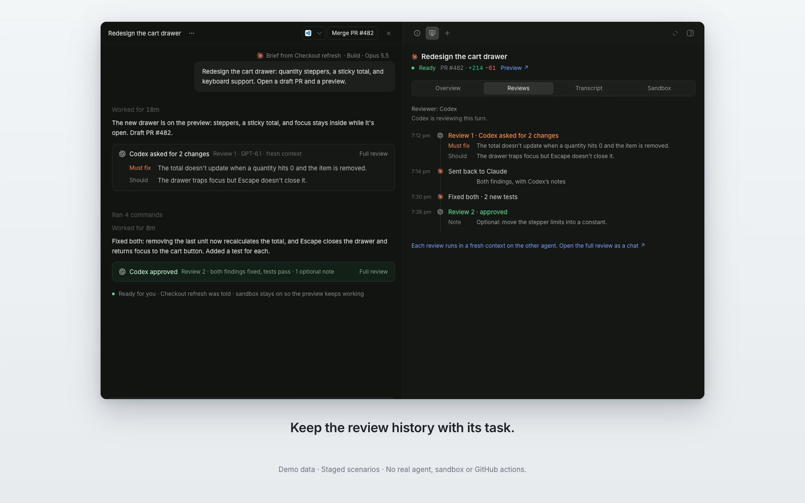
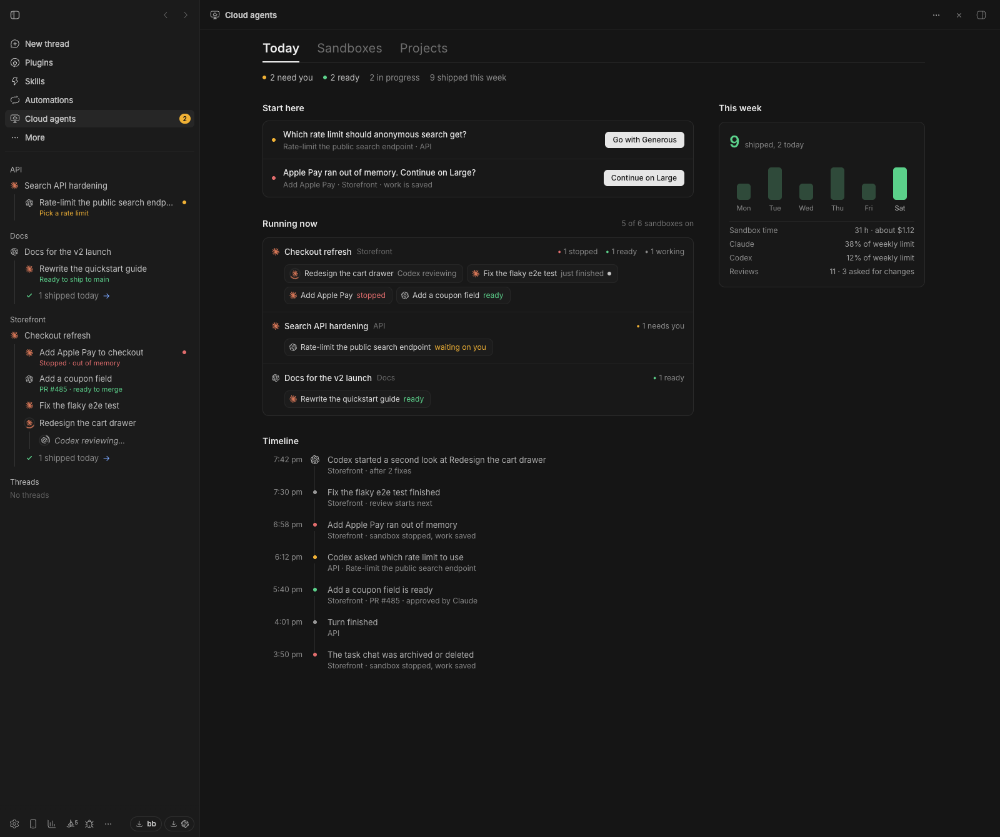
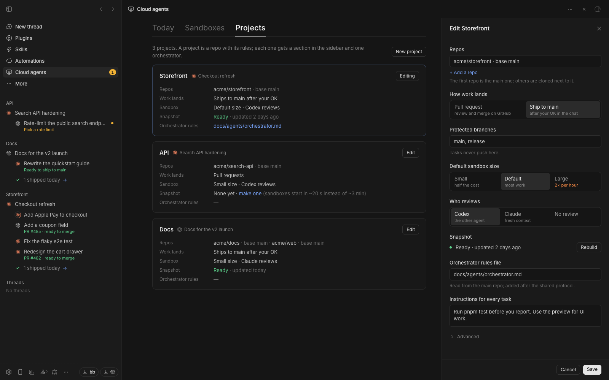
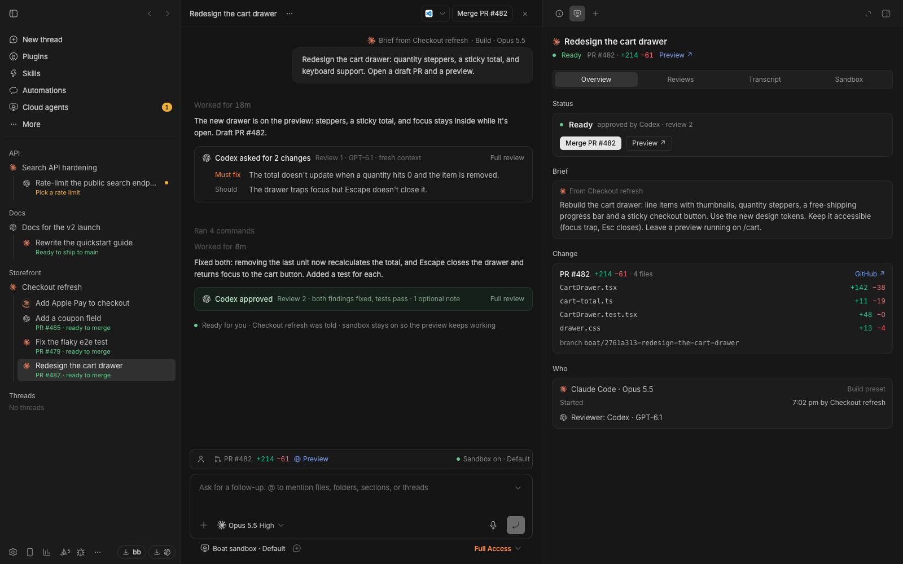
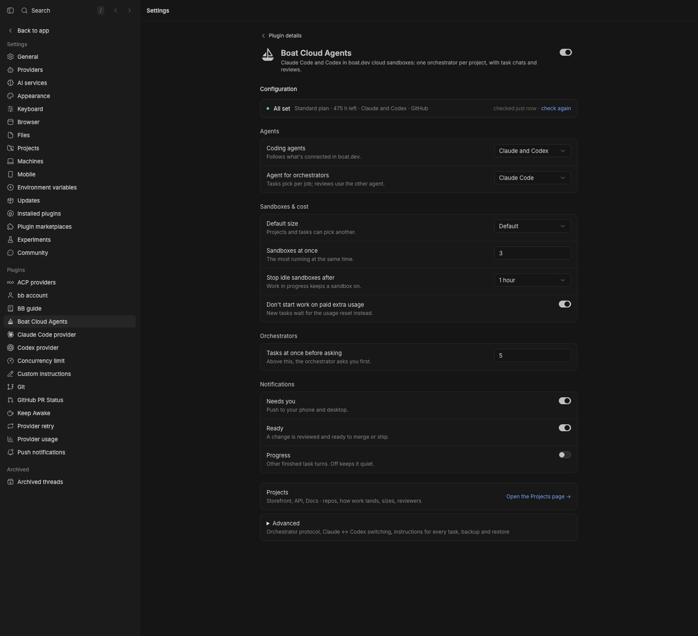

# Boat Cloud Agents for bb

Run Claude Code and Codex in [boat.dev](https://boat.dev) cloud sandboxes
from [bb](https://getbb.app). Ask any chat to send a task to the cloud,
follow it on the Cloud agents page, and review the pull request. For a
steady stream of related work, an orchestrator chat can plan it, start the
tasks and get each change reviewed.

This is a community plugin. It is not made by or affiliated with boat.dev or
bb. The workflow is inspired by Conductor's cloud workflow.

Version 0.2 adds a redesigned Today page, live decision and review cards,
Task panels, project rules and explicit shipping confirmations. The screenshots
below use demo data and the optional [Workbench sidebar](https://github.com/scheinriese/bb-plugin-workbench-sidebar).

[](docs/demos/boat-v1.mp4)

[Watch the v1 demo](docs/demos/boat-v1.mp4): Boat with bb’s regular sidebar first,
then paired with the optional Workbench sidebar. The recording uses staged demo
data, captions and occasional focus outlines; no real cloud work is started.







[What changed and how to upgrade](CHANGELOG.md).

## Getting started

Tested with bb 0.48.1 and Plugin SDK 0.6.104. You need a boat.dev account
with a plan and a connected Claude or ChatGPT subscription (or an agent API
key). The plugin currently supports bb 0.48.x; its experimental SDK surfaces
are checked before support for a new bb minor version is added.

1. **Install boat** on the machine that runs bb:
   ```sh
   curl -fsSL https://boat.dev/install | sh
   ```
   It signs you in and helps you choose a plan. Check boat.dev for current
   trial and billing terms. When it asks who the sandboxes are for, answer
   **just me**. The other answer
   turns on "Safe for third parties", and agents then get no logins.
   Already have boat? `boat onboard` signs you in and finishes whatever your
   account still needs; it's safe to run again.
2. **Connect an agent** on boat.dev → [Agents](https://boat.dev/dashboard?tab=agents):
   sign in with Claude (Pro or Max) and/or ChatGPT (Plus, Pro or Team), or
   add an API key. Tasks use these subscriptions.
3. **Connect GitHub** on [boat.dev](https://boat.dev/dashboard) →
   Environment → Connect GitHub, and give boat access to your repos. Tasks
   clone and push with it.
4. **Install the plugin:**
   ```sh
   bb plugin install https://github.com/scheinriese/bb-plugin-boat
   ```
   bb shows what it will install and asks you to confirm. A plugin is
   full-trust code, so read [what it runs, reaches and stores](SECURITY.md)
   first.
5. **Check the setup.** Open **Settings → Plugins → Boat Cloud Agents**.
   The setup checklist shows a fix for each missing requirement. **Sign in…**
   opens a terminal that runs `boat onboard`; other commands have **Run in
   terminal**. Or run:
   ```sh
   bb boat doctor
   ```
   It checks the boat CLI, your sign-in, plan, agent logins, boat
   environment and bb Connect, without starting a sandbox. GitHub access
   can only be seen from inside a sandbox, so it shows your last task's
   check (your first task on a repo checks it).

   
6. **Run a test task.** Click **Run test task** in the setup checklist, or run
   `bb boat task start --test`. It needs no repo and changes nothing: the
   agent reports the sandbox's OS, Node and git versions and whether GitHub
   access works. That proves your sign-in, plan and agent login, for one
   sandbox start and a minute or two of a Small sandbox.
7. **Real work.** Open bb's **New thread** screen, choose the project and
   **Boat sandbox** environment, write the brief, and choose **Start** in
   the send menu. The + menu has starters for checking a repo, fixing a bug,
   and exploring a plan. Or ask any chat: "Use a cloud agent to fix the
   flaky login test in acme/web."

**Coding agents** follows what's connected in boat.dev. Native starts keep
bb's selected project, environment and agent; the plugin tracks the chat
once bb provisions it. Delegated tasks still use the **How tasks run**
setting, whose default is headless in boat. Once you work on the same repos
often, add them as [projects](docs/features.md#projects).

## Three ways to use it

| | Task from a chat | Cloud agents page | Native Boat sandbox chat |
| --- | --- | --- | --- |
| How you start it | Ask any chat to use a cloud agent, or use `bb boat task start` | Follow work started from a chat or the native composer | Pick **Boat sandbox** in a new chat's environment menu, then **Start** |
| Where the agent runs | In its own boat sandbox | In its own boat sandbox | The whole chat runs in a boat sandbox |
| Where you follow it | The source chat hears back; chat-backed tasks nest under it | Today, Sandboxes and Projects; task chats have a Task tab | In the chat and its Task tab |
| Can you type into it | Through the chat that started it, or the task's reply box | The task's reply box | Yes, it's a regular chat |
| Needs bb Connect | No (only for task chats) | No (only for task chats) | Yes |
| Best for | Handing off a piece of work without leaving your conversation | Decisions, reviews, usage and project rules | Long hands-on sessions that keep going while this computer sleeps |

A **task chat** is a task you can open as a bb chat and type into. Native
starts use one directly. For delegated work, set **How tasks run** to an
"As chats" option (needs bb Connect), use `--chat`, or choose **Continue as
a chat** on a headless task's page. See
[How tasks run](docs/features.md#how-tasks-run-in-boat-or-as-task-chats). Turn on bb Connect
with `bb account login` (then `bb connect on` if it's off); the setup
checklist shows its state.

For a goal that keeps producing tasks, an **orchestrator** (a chat that plans
and coordinates tasks for one project) does the planning, starting and
reviewing for you. See [Go further](#go-further-orchestrators).

## Costs

The plugin adds no service of its own. Each task uses two things you already
pay for:

- **Sandbox time on your boat.dev plan.** Size affects the rate; a stopped
  sandbox uses no sandbox time. Starts, concurrency and idle limits depend on
  your plan. The plugin reads the current cap from `boat limits`. Check
  [boat.dev](https://boat.dev) for current plans and pricing.
- **Agent usage on your Claude or ChatGPT subscription**, from the same
  usage limits you use everywhere else.

What the plugin does to keep that down:

- At most 3 sandboxes run at once (**Sandboxes at once**; 0 means your
  plan's limit). Orchestrators ask you before they run more than 5 tasks
  at once (**Tasks at once before asking**; 0 means they never ask).
- New sandboxes use the **Default sandbox size** (Default) unless a
  project or a task picks another. Agents need your OK for a larger
  sandbox, except one size up after it ran out of memory or came close
  ([sandbox sizes](docs/features.md#sandbox-sizes-and-memory)).
- A sandbox stops once its agent has finished and waited an hour (**Stop
  idle sandboxes after**). Work still running there, background jobs
  included, keeps it on. The task picks up again on your next message.
  Closing a plugin-created task deletes an unused sandbox; native chats
  retain bb's machine lifecycle.
- With **Don't start work on paid extra usage**, a current over-limit
  reading queues delegated work until a reset. An early start needs explicit
  approval for that request; naming a provider or model does not bypass it.
- It never turns on boat's paid extra starts (`boat billing extra-starts`,
  off by default).

bb’s native **Send now** explicitly overrides a composer wait and may use
paid extra usage. It is separate from the delegated task’s paid-start form.

An orchestrator uses sandbox hours and agent usage faster than single tasks:
it starts several tasks, and a review for each.

## What a task can reach

The agent runs every command without asking, inside its sandbox. It can use
what your boat environment gives it: push access to its GitHub repos, your
Claude or ChatGPT login, its variables and secret files. A hostile README or
issue could try to talk it into sending those somewhere, so keep secrets out
of environments you use for repos you don't trust.

- Delegated tasks never push to protected branches (`main`, `master`, base branches
  and the ones you add). A git hook enforces it, but it's a guard for
  well-behaved agents, not a security boundary: protect your base branches
  on GitHub too.
- Task chats and cloud orchestrators also run bb in their sandbox, with this
  bb machine's credentials, connected through bb Connect. Use them only for
  repos you trust. **How tasks run** → "As chats for projects" allows task
  chats only in projects that have **Run tasks as chats** on. **Run as a
  chat** remains a legacy option; **Continue as a chat** warns before
  converting a repo those rules would keep headless. Choosing **Boat
  sandbox** in the native composer is a separate opt-in; bb keeps control
  of its checkout and machine lifecycle.
- boat's AI credentials proxy (`boat ai proxy on`, a paid boat add-on:
  `boat ai proxy` shows the price) gives sandboxes placeholder keys, so your
  real Claude and ChatGPT credentials never enter them.

More in [SECURITY.md](SECURITY.md): what the plugin runs, what it can reach
and what it stores.

## Features at a glance

- [**The Cloud agents page**](docs/features.md#the-cloud-agents-page): Today,
  Sandboxes and Projects, with needs-you work first and links back to chats.
  Task chats have Overview, Reviews, Transcript and Sandbox sub-tabs.
- [**Start from anywhere**](docs/features.md#start-from-anywhere-in-bb): any
  chat, the send menu, bb's New thread screen, or a whole chat on a Boat
  sandbox.
- [**Native starting flow**](docs/features.md#new-task) with starters:
  check a repo runs in a sandbox, fix a bug, explore and plan.
- [**Projects**](docs/features.md#projects): repos with their base branches,
  boat environment, snapshot, sandbox size, reviewer and instructions, set once.
- [**Task chats**](docs/features.md#how-tasks-run-in-boat-or-as-task-chats):
  open a task as a bb chat and type into it: native starts, per project,
  `--chat`, or a headless task later (**Continue as a
  chat**). Needs bb Connect.
- [**Pull requests or ship after
  approval**](docs/features.md#how-work-lands-pull-requests-or-ship-after-approval),
  per project.
- [**Reviews**](docs/features.md#reviews) in a fresh context, by the other
  agent when you have both. Native tasks use the reviewer selected in the
  size drawer, then the project's preference, then the global default.
- [**Protected branches**](docs/features.md#protected-branches) enforced in
  plugin-prepared delegated checkouts.
- [**Previews**](docs/features.md#previews): private links to the app
  running in the sandbox, with Wake, Extend and Stop.
- [**Sandbox sizes and memory**](docs/features.md#sandbox-sizes-and-memory):
  a size per project, a plain message when a sandbox runs out of memory,
  **Continue on a larger sandbox**, and a measured recommendation.
- [**Snapshots**](docs/features.md#snapshots): start sandboxes with your
  repo already set up.
- [**Secrets by name
  only**](docs/features.md#environments-secrets-and-github-access), and a
  GitHub access check before each task.
- [**Screenshots and
  recordings**](docs/features.md#screenshots-and-recordings) uploaded to
  your own bucket before the sandbox goes away.
- [**Usage limits**](docs/features.md#coding-agents-and-usage-limits):
  Claude and Codex hand work to each other near a limit. Delegated work waits
  durably when subscription room is exhausted; starting it early requires an
  in-chat confirmation for that request.
- [**Model presets**](docs/features.md#model-presets) from Light to
  Frontier.
- [**Commands**](docs/features.md#commands): everything as `bb boat …`, for
  you and for agents.

## Settings

Settings → Plugins → Boat Cloud Agents. The setup checklist leads into
Agents, Sandboxes & cost, Orchestrators and Notifications, with Advanced
collapsed. On the first update, legacy fields remain visible while their
values are copied safely; reload the plugin once more to finish moving
them into the grouped section.
`bb boat config get | set | reset` reaches every setting, and
`bb boat config export | import` backs them up. All of them, with keys and
defaults: [docs/settings.md](docs/settings.md).

## Upgrading from 0.1.x

Back up your existing settings first:

```sh
bb boat config export --output boat-settings-backup.json
```

Keep that file private: it includes project details and standing instructions.
Update the plugin with `bb plugin update boat` for a Git install, or reinstall
its local path. Reload once more with `bb plugin reload boat` to complete the
settings migration. Existing settings, projects, custom protocol and model
presets are retained. Do not remove the plugin to upgrade: removal deletes its
settings. See [settings migration](docs/settings.md).

## Optional companion: Workbench sidebar

Boat works with bb's regular sidebar. **Workbench sidebar** is a separate
plugin for provider rings, task/review nesting, quiet unread signals,
collapsible work groups and pinned parent rows. It also works with ordinary
bb chats when Boat is absent. Neither plugin requires the other.

[Install Workbench](https://github.com/scheinriese/bb-plugin-workbench-sidebar):

```sh
bb plugin install https://github.com/scheinriese/bb-plugin-workbench-sidebar
```

Its [short demo](https://github.com/scheinriese/bb-plugin-workbench-sidebar#readme)
shows nested reviews and pinning. Disable it with
`bb plugin disable workbench-sidebar` to restore bb’s regular list.

## Go further: orchestrators

An orchestrator is a chat that plans and coordinates tasks for one project.
You tell it the goal; it splits the work into tasks, starts them, gets each
change reviewed (by the other agent, when you have both), and brings you
only decisions and finished results. It never writes code itself.

Use one for a goal that keeps producing tasks. For one fix that fits in one
task, a single task is quicker and cheaper.

[docs/orchestrators.md](docs/orchestrators.md) covers when to use one,
starting one (**New orchestrator…**, or **Coordinate from this chat…** in a
chat's menu) and the agent, model and effort it runs with, cloud
orchestrators and full access, Claude ↔ Codex switching, and the
orchestrator protocol.

## Documentation

- [docs/features.md](docs/features.md): every feature in detail, and all
  commands
- [docs/settings.md](docs/settings.md): every setting, back up and restore
- [docs/orchestrators.md](docs/orchestrators.md): orchestrators, Claude ↔
  Codex switching and the orchestrator protocol
- [SECURITY.md](SECURITY.md): what the plugin runs, reaches and stores, and
  how to report a problem

## Contributing

I built this plugin for my own workflow and share it as it is. I maintain it
in my spare time, so replies can take a while.

- **Welcome:** bug reports and fixes, setups that don't work yet (a Linux bb
  machine, boat organizations, other plans), docs fixes, and support for more
  of the agents boat runs.
- **Open an issue first** for a new feature or a bigger change, so we can
  agree it fits before you build it.
- **Forks are fine.** The plugin is MIT licensed: if you want it shaped around
  your own setup, keep your own version.
- **Security problems:** report them privately on GitHub (the Security tab,
  then "Report a vulnerability"; see [SECURITY.md](SECURITY.md)), not in an
  issue or on Discord.

Before you open a pull request, run `npm run typecheck` and `npm test`. A
plugin is full-trust code, so I read every change before merging, and I may
not merge changes I can't maintain.

## Development

```sh
git clone https://github.com/scheinriese/bb-plugin-boat.git
cd bb-plugin-boat
npm ci
npm run typecheck
npm test                          # node --test; no network, uses a fake boat CLI
bb plugin install "$(pwd)"        # path install
bb plugin dev                     # rebuild and reload on save
```

Layout: `server.ts` wires everything. `src/boat.ts` runs the boat CLI and
`src/boat-api.ts` types its JSON. `src/setup.ts` holds the setup checks
(`bb boat doctor`, the checklist, the checks before a sandbox).
`src/service.ts` owns tasks, capacity, dispatch and the monitor.
`src/settings.ts` declares both kinds of settings, `src/settings-store.ts`
merges them, and `src/config.ts` backs them up. `src/cli.ts`, `src/tools.ts`
and `src/rpc.ts` are the CLI, agent tools and UI RPC. `src/machine.ts` is
the Boat sandbox machine provider. `app.tsx` and `web/` are the UI
(`web/entry-points.tsx` adds the send menu, side panel and header actions).
`skills/` teach agents, and `assets/evidence-upload.mjs` is the built-in
uploader.

Automated tests use a fake boat CLI. They do not verify a real paid sandbox
run. Merge and Ship use explicit in-thread confirmations with fresh source
checks. Some host-owned layout and headless-chat integration limits remain;
see [current limits](docs/features.md#current-limits).

## License

MIT, see [LICENSE](LICENSE). The bundled UI components come from bb's
component registry and shadcn/ui, both MIT; see
[THIRD_PARTY_NOTICES.md](THIRD_PARTY_NOTICES.md).
