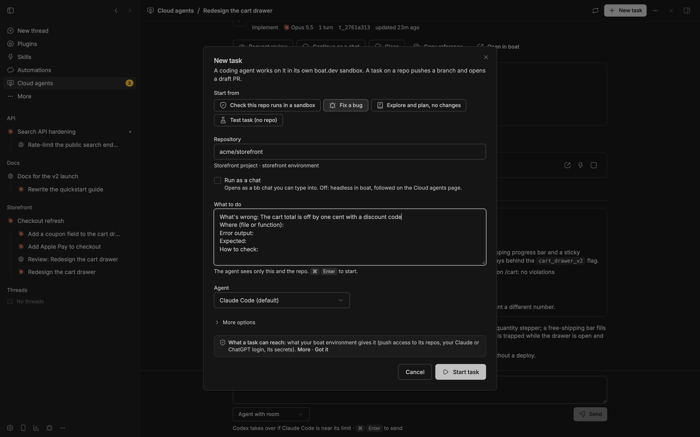

# Features

Everything Boat Cloud Agents does, section by section. To get started, see
the [README](../README.md); for every setting, [settings.md](settings.md);
for orchestrators, [orchestrators.md](orchestrators.md).

## The Cloud agents page

The page in bb's sidebar changes with what you have:

- **Until the setup is complete:** the "Set up cloud agents" checklist (if
  you already have tasks, it sits above them). Each row says what's missing
  and how to fix it: a command to copy or **Run in terminal**, a button
  that opens boat.dev, or **Sign in…**. Optional things (bb Connect,
  GitHub, the GitHub CLI, a first project) sit under "Later, if you need
  them".
- **Before your first task:** "Start your first task", with the
  [three ways to use it](../README.md#three-ways-to-use-it) and **Run a test
  task**.
- **Every day:** a status line (your boat plan, sandboxes against your limit, sandbox
  hours left, each agent's usage), then **Ready to review** (finished work
  with its note, pull request and preview link), **Running**, **Previews**
  (live and sleeping ones), **Sandboxes** (each says what uses it) and
  **Recently done**.
- **With an orchestrator:** **Needs you** (decisions only you can make) and
  **Orchestrators** move to the top.

The header has **New task**, and a ⋯ menu with **New sandbox**, **New chat
in a Boat sandbox** and **New orchestrator…**. Each task opens a page with
its report, review, transcript, previews, history and a reply box, plus
**Request review** and, where it applies, **Ship** or **Save as snapshot**
(a finished test task offers **New task** instead). In the reply box,
**Agent with room** (the default with both agents) continues on the task's
agent, or on the other one when it's near its limit; **Keep Claude** (or
Codex) never switches.
A task started from a chat shows "From" and the chat's name; one started by
an orchestrator links to it. A finished turn of a task you started (from a chat
or the page) lands in **Ready to review**; an orchestrator's tasks wait for
the orchestrator first.

## Start from anywhere in bb

- **Any chat:** ask it to use a cloud agent. The `boat` skill teaches it
  `bb boat task start`. The chat gets a `[boat]` message when the task's
  turn ends, so you don't need to watch it.
- **The send menu:** **Send to a cloud agent** in a chat sends your message
  with a request to use one. On bb's New thread screen, **Start as a cloud
  task** turns your draft into a task (the repo comes from the chat's
  project).
- **The New thread screen's side panel:** **Start a cloud task** opens the
  New task form.
- **The environment menu:** **Boat sandbox** runs a whole chat in a
  sandbox, with a size chip next to it. Sizes your plan can't use are
  greyed out with boat's reason.
- **A task chat's header:** **Ship** and **Request review**. An
  orchestrator's header has **Open board**.
- **A chat's menu:** **Coordinate from this chat…** makes it the
  orchestrator for a project.
- **bb's home screen:** "Hand a task to a cloud agent", with **New task**.

## New task



New task asks for the repo, what to do and the agent; branch, base branch,
role, model, sandbox and size are under **More options**. Starters fill in
the brief:

- **Check this repo runs in a sandbox:** installs, tests and starts the
  app without changing code, and reports what the boat environment is
  missing. It runs on the Light model preset. When it's done, **Save as
  snapshot** keeps that sandbox's setup, and the project's tasks can start
  from it.
- **Fix a bug:** what's wrong, where, the error output, what you expected
  and how to check.
- **Explore and plan, no changes** (on the Review model preset).
- **Test task (no repo).**

A good brief has the goal, the context (files, issues, earlier decisions),
the constraints, how to check the result, and anything special about the
pull request. The agent can't ask questions mid-task. The plugin adds the
checkout, the push rules and a report block at the end of the agent's
answer.

## Projects

A project is one or more GitHub repos, each with a base branch, plus the
boat environment its tasks start in. Single tasks don't need one, but a
project lets you set things once per repo, and every orchestrator works on
one. New installs start with none.


- Add one in Settings → Plugins → Boat Cloud Agents → Projects, or:
  ```sh
  bb boat project add --name "Web app" --repo acme/web@main --environment web
  ```
  Repeat `--repo` for more repos; the first is the main one, and tasks
  clone the others next to it.
- Per project: the boat environment, a snapshot tasks start from, the
  sandbox size its tasks use, how work lands, **Run tasks as chats**,
  protected branches, instructions added to each task's brief, and an
  orchestrator rules file in its main repo.
- From the command line:
  ```sh
  bb boat project set web-app --protected-branches "release, develop" --instructions-file house-rules.md
  ```
  `none` clears protected branches or instructions.

## How tasks run: in boat, or as task chats

**How tasks run** decides what a task's agent is:

- **In boat** (default): headless in boat. You follow it on the Cloud
  agents page (transcript, report, reply box). No bb runs in the sandbox,
  and bb Connect isn't needed.
- **As chats for projects:** tasks on repos of projects with **Run tasks as
  chats** on are bb chats on their sandbox, nested under the chat that
  started them. Other repos still run in boat (with an "Untrusted repo"
  badge).
- **As chats everywhere:** every task is a task chat, unless its project
  has **Run tasks as chats** off.

Open a task chat to watch every step or write to it; the plugin treats your
turn as part of the task. Ultracode (Claude) and Ultra (Codex) work there.
Task chats need bb Connect and take about a minute longer to start. Their
sandbox holds bb machine credentials, so keep them for repos you trust.

Idle sandboxes stop on their own. Their files and agent conversations
survive and resume on the next follow-up. Closing a task deletes its
sandbox, unless another open task uses it.

## How work lands: pull requests, or ship after approval

Each project picks one (Projects → "How work lands", or
`bb boat project set <id> --delivery pr|push`):

- **Draft pull requests** (default): the agent pushes its own branch and
  opens a draft pull request against the base branch. You merge it on
  GitHub.
- **Ship to the base branch after I approve:** the agent only commits, in
  its sandbox. A git hook refuses its pushes to GitHub, so nothing gets
  there until you approve. Reviews run in the task's sandbox, where the commits
  are. Then you ship:
  - **Ship** on the task's page, card or task chat header: your click is the
    approval. It shows once a finished turn left commits or changed files;
    a task that changed nothing has nothing to ship.
  - Or tell the orchestrator in its chat; it calls `boat_ship`. The plugin
    only ships from the task's own orchestrator chat, after the latest turn
    was reported there and you wrote in that chat since. An agent claiming
    you approved isn't enough.
  - The plugin rebases the commits onto the latest base branch and pushes.
    It never forces. Uncommitted changes, files the agent never added, or
    conflicts stop it before anything is pushed. Then the task closes and
    its sandbox is deleted.
  - Until it ships, the sandbox holds the only copy. Closing or cancelling
    such a task asks you to discard the work, and `bb boat sandbox delete`
    refuses. A task with nothing to ship closes like any other. boat deletes stopped sandboxes after 14 days, so after 10 days
    you get a Needs-you question.

## Reviews

**Request review** (on a task's page, in a task chat's header, or
`bb boat task review <id>`) starts an independent review in a fresh context.
With both agents it runs on the other one: **Agent for reviews** (Codex by
default), or the other agent when the task already ran on that one. With one
agent, the same agent reviews. The review reports a verdict and its
findings; send them back with a follow-up.

## Protected branches

Tasks never push to `main`, `master`, the task's base branch, the base
branch any of your projects uses for that repo, a project's protected
branches, or the branches in **Extra protected branches** (Advanced). The
plugin refuses tasks that point at one, and a git pre-push hook in every
task checkout enforces it. Pushes to a folder inside the sandbox (say, a
temporary remote your repo's own tests create) are let through: they can't
reach GitHub.

The hook is a guard for well-behaved agents, not a security boundary. For
hard enforcement, protect your base branches on GitHub.

## Previews

Agents leave a preview running when their change shows in a browser, and
report it in their report block:
`PREVIEW: port=4321 path=/settings cmd="npm run dev -- --host 0.0.0.0 --port 4321"`.

- The plugin runs `boat host <sandbox> <port> --private` and keeps the link,
  port, page and command. Private links carry a token (`?_token=…`): the
  first visit sets a cookie and opens the page, so the link works in any
  browser. Nobody without the link gets in.
- Previews show as **live**, **sleeping** (the sandbox stopped, or the
  server isn't running) or **expired** (the sandbox is gone), with the time
  left before auto-stop. The Cloud agents page lists live and sleeping
  ones; expired ones stay on their task's page.
- **Wake** resumes the sandbox, restarts the stored command, hosts the port
  again (same link) and opens it. **Extend** keeps the sandbox on 2 more
  hours (at most your plan's auto-stop cap). **Stop** stops the sandbox.
- A sandbox with a live preview whose task waits on you isn't stopped as
  idle, and it's the last one stopped to make room.
- `bb boat preview list | wake | extend | stop`, and `boat_preview` for
  orchestrators.

## Sandbox sizes and memory

Sandboxes come in four sizes: Small (2 vCPU, 4 GB, half rate), Default
(4 vCPU, 8 GB), Large (8 vCPU, 16 GB, double rate) and XLarge (16 vCPU,
32 GB, needs a bigger boat plan). Your plan says which you
can use.

- **Which size a new sandbox gets:** the size you pick for the task, else
  its project's **Sandbox size** (the project the task belongs to, or the
  one whose main repo it is), else the **Default sandbox size** setting. A
  project size your plan doesn't include falls back to the setting, with a
  note in the task's history; a size you pick that the plan doesn't include
  is refused before anything starts. A review in a new sandbox gets at
  least its task's current size.
  ```sh
  bb boat project set web-app --size large     # none: the setting
  ```
- **Agents know their size.** Every task's prompt says the sandbox's size,
  CPUs and memory (read inside the sandbox, new or reused), that other
  processes share it, and to run heavy test suites one at a time.
- **Out of memory.** When a turn fails, is cut off or ends without a new
  message, the plugin reads the sandbox's kernel log for out-of-memory kills
  in that turn. The task's error then says so in plain words, for example
  "The sandbox ran out of memory: the system stopped a 1.4 GB process in the
  task chat (MainThread)", with the original error kept as detail; the
  orchestrator's notice says what to do. Without a readable kernel log it
  only notes that the sandbox may have run out of memory. These facts are
  measured inside the sandbox, so treat them as a strong hint, not proof.
- **Continue on a larger sandbox.** After an out-of-memory failure the task
  page offers it, and **Change size…** in the task's Sandbox row works
  between turns. The sandbox stops and starts again on the new size (one
  boat start): files stay, running processes stop (Wake restarts previews),
  and other open tasks on it move too. Then your message goes to the agent,
  which is told the new size. A move boat refuses (it won't shrink a
  sandbox whose data doesn't fit) puts it back on its old size.
  ```sh
  bb boat task followup t_1a2b3c4d --type large --message "Continue where you left off."
  bb boat sandbox resize bx_k3p9 --type default    # only the size
  ```
  Orchestrators use `boat_followup` with `sandbox_size`: only to a larger
  size, Large after an out-of-memory failure (otherwise with your OK),
  XLarge only with your OK.
- **Measure instead of guess.** "Check this repo runs in a sandbox" (and
  the test task) samples the sandbox's memory every second during the turn
  and shows the peak with a recommended size, for example "Peak memory: 6.1
  of 8 GB. Recommended size: Large": the next size up when the peak reached
  75% of the sandbox's memory or something was killed for memory. **Use
  Large for Web app** sets the project's size.

## Snapshots

- Start sandboxes from a saved snapshot: set it on a project, or pass
  `--snapshot <name>` to `bb boat task start` (`none` starts fresh).
- **Save as snapshot** on a finished "Check this repo runs in a sandbox"
  task, or `bb boat sandbox snapshot <id> <name>`, saves one;
  `bb boat sandbox snapshots` lists them with your plan's allowance.
- Sandboxes that run bb (task chats and cloud orchestrators) can't be
  saved: their disk holds bb's login.
- A missing snapshot, or a plan without snapshots, gets a plain message
  instead of boat's raw error.

## Environments, secrets and GitHub access

Tasks start in a **boat environment**: the repos it clones, the variables
and secret files it injects, and whether your GitHub and AI logins go in.
Empty **Boat environment** uses your boat default; a project can pick its
own.

- **Create one and add secrets** on the boat.dev dashboard, or with the boat
  CLI: `boat env new web`, then `boat env set-var web KEY` (the value comes
  from stdin, so it stays out of your shell history), and
  `boat env set-file web .env.local --from ./my.env` for files. Running
  sandboxes keep the old version until `boat env upgrade web`.
- **"Safe for third parties"** hides your agent logins and GitHub from
  sandboxes. While it's on, the setup check fails and tasks don't start;
  turn it off on boat.dev → Environment or with
  `boat env set <name> --safe-for-third-parties false`.
- **Secrets by name only.** The plugin shows an environment's secret names
  (project settings, `bb boat status`). It drops the values as soon as it
  reads `boat env info`, so it never puts them in the UI, the logs or a
  chat. Agents can still read them in their sandbox: that's what the
  environment is for.
- **Repo access.** Before a task starts, the plugin asks GitHub from inside
  the sandbox what boat's login may do with each repo. No access stops the
  task with "Connect GitHub on boat.dev → Environment and give boat access
  to this repo". Read-only access is enough for reviews, not for tasks that
  push. The last result per repo shows in the project settings and
  `bb boat status`; the setup checklist shows the newest one.
- **Expired GitHub logins.** boat gives sandboxes a GitHub token that lasts
  about 8 hours. Before a follow-up that needs GitHub (a push, a pull
  request) or a ship, the plugin checks it. An expired one is reported with
  what to do: `boat env upgrade <name>` to refresh running sandboxes, or a
  new task.

## Screenshots and recordings

A task's sandbox is deleted when the task closes, so agents upload their
screenshots and recordings before they finish. This is off by default. Turn
it on in Settings → Setup → **Screenshots and recordings**
(`evidenceUploader`):

- **Off** (empty, the default).
- **Built-in uploader** (`builtin`): the uploader that ships with the plugin
  (`assets/evidence-upload.mjs`). It has no dependencies, needs Node 20+ in
  the sandbox, and uploads to any S3-compatible bucket (Cloudflare R2, AWS
  S3, MinIO and others).
- **Your own script** (`owner/repo:path[@ref]`): fetched from GitHub with
  the bb machine's `gh` login. Pin it to a commit (`@<commit sha>`), so a
  later push to that repo can't change what runs in your sandboxes.

Every task sandbox then gets an `evidence-upload` command. Agents run
`evidence-upload <files or folders> --name <short label>`. It prints one
link per file, and they paste the links into their report (with an
`EVIDENCE:` line in the report block). `evidence-upload --link <key>` prints a
fresh link for a file already uploaded, and `--help` shows all options of
the built-in uploader.

The built-in uploader reads its configuration from environment variables.
Set them in your boat environment, never in the plugin settings:

| Variable | Needed | Meaning |
| --- | --- | --- |
| `EVIDENCE_BUCKET` | yes | Bucket name |
| `EVIDENCE_ACCESS_KEY_ID`, `EVIDENCE_SECRET_ACCESS_KEY` | yes | Keys with write access to the bucket. `EVIDENCE_R2_ACCESS_KEY_ID` / `EVIDENCE_R2_SECRET_ACCESS_KEY` and `AWS_ACCESS_KEY_ID` / `AWS_SECRET_ACCESS_KEY` work too |
| `EVIDENCE_ENDPOINT` or `CLOUDFLARE_ACCOUNT_ID` | for R2 and other S3 services | The S3 endpoint URL. With only `CLOUDFLARE_ACCOUNT_ID`, it's `https://<account id>.r2.cloudflarestorage.com`. Without either, AWS S3 (`https://s3.<region>.amazonaws.com`) |
| `EVIDENCE_REGION` | no | Default `auto` for R2, else `us-east-1` |
| `EVIDENCE_LINK_DAYS` | no | How long links work, 1–7 days (default 7) |

For example, for Cloudflare R2:

```sh
boat env set-var web EVIDENCE_BUCKET
boat env set-var web EVIDENCE_ACCESS_KEY_ID
boat env set-var web EVIDENCE_SECRET_ACCESS_KEY
boat env set-var web CLOUDFLARE_ACCOUNT_ID
bb boat config set evidenceUploader builtin
```

- Keep the bucket private. Links are presigned: anyone with a link can open
  that file until the link expires.
- The task history says which variables a sandbox is missing (names only).
  A failed install never stops a task; the agent then reports that uploads
  failed.
- When a report mentions screenshots or recordings without links, an
  orchestrator asks the agent to upload them before closing the task
  (`boat_followup` with `evidence_only`, or
  `bb boat task followup <id> --evidence-only`).
- `bb boat task show` lists every link a task's turns uploaded.

## Coding agents and usage limits

**Coding agents** is on Auto-detect by default: the plugin reads which
Claude and ChatGPT logins are connected in boat.dev for the environment new
sandboxes use. With one agent, every task and review runs on it (reviews
still run, in a fresh context), and switching agents is off. Pick by hand
(Claude and Codex, Only Claude, Only Codex) if bb's Account Pooler logs your
task chats in instead. When your choice disagrees with boat.dev, the setup
checklist warns and offers **Use Auto-detect**.

- **Don't start work on paid extra usage** (on by default): when every
  agent you have is near its usage limit, new tasks wait for a reset
  instead. The start fails with `agents_at_limit`, and you're told. Chats
  already running carry on.

With both agents:

- New tasks start on **Agent for tasks** (Claude Code by default), and
  reviews run on **Agent for reviews** (Codex), so each change gets a
  second opinion from the other model.
- **When an agent hits its limit mid-task, continue with the other one** (on
  by default): the task carries on with the other agent in the same
  sandbox. A follow-up also goes to the other agent when the task's agent
  is at or above **Switch at** (90% by default) and the other has room; a
  review does when the agent picked for it is. The task history says so, for example "Claude is at 95% of its
  limit; continued with Codex". This never happens when you or an
  orchestrator asked for a specific agent (by name, a model, or an effort
  level only one agent has), and steers stay with the running agent.
- **Claude ↔ Codex switching for orchestrators** (off by default) moves an
  orchestrator to the other agent near a limit. See
  [Orchestrators](orchestrators.md#claude--codex-switching).

Usage readings come from bb's Provider usage (the Account Pooler for the
agents it routes, else the Claude Code and Codex providers). Reading them
costs no tokens. When any chat on this bb fails on a usage limit, that agent
counts as full until the limit resets. `bb boat relay status` shows each
agent's usage.

## Model presets

A task can run with a model preset: Light, Review, Build, Deep or Frontier
(`--tier` on the command line). The preset picks the model and effort for
the task's agent, and the plugin records preset, model, effort and the
reason on the task. Orchestrators always pick one. Edit the table in
Settings → Models when model ids change:

| Preset | Claude | Codex | Use for |
| --- | --- | --- | --- |
| Light | claude-sonnet-5-5 · high | gpt-6.1-sol · medium | Mechanical or exactly specified work |
| Review | claude-opus-5-5 · high | gpt-6.1-sol · high | Reviews and audits; small fixes with a known cause |
| Build | claude-opus-5-5 · xhigh | gpt-6.1-sol · xhigh | Normal implementation and debugging |
| Deep | claude-opus-5-5 · ultracode | gpt-6.1-sol · ultra | Parallel exploration plus independent checking |
| Frontier | claude-fable-5-1 · xhigh | gpt-6-astra · xhigh | Only after Deep fell short |

- Without a preset, tasks use **Model for tasks** and reviews **Model for
  reviews** (Settings → Models); empty means the Build and Review presets.
- Tasks in boat can't use Ultracode or Ultra, so there Deep runs at max and
  the brief asks Claude to use helper agents.
- Model ids are bb's (`claude-opus-5-5`); tasks in boat get boat's
  (`opus-5-5`).
- Frontier at max, Ultracode or Ultra is refused unless you approved it
  (`--user-approved`).
- A follow-up keeps the task's preset.

## Commands

Everything is available as `bb boat …`, from any chat or terminal. Every
command has `--help`, and `--json` gives machine-readable output.

| Command | Purpose |
| --- | --- |
| `bb boat doctor` | Check the setup, with a fix for each problem; never starts a sandbox |
| `bb boat status` | Setup summary, plan limits, sandboxes, open tasks, repo access |
| `bb boat task start --test` | Start the test task: no repo, changes nothing |
| `bb boat task start --title … --brief …` | Start a task (`--repo`, `--project`, `--agent`, `--tier`, `--snapshot`, `--sandbox`, `--type` …) |
| `bb boat task review <id>` | Independent review of a task's work |
| `bb boat task followup <id> --message …` | Next turn (`--agent` switches agent, `--tier` changes preset, `--steer` redirects a running turn, `--type large` moves its sandbox to another size first) |
| `bb boat task show \| transcript \| list \| interrupt \| close` | Inspect and finish tasks |
| `bb boat task ship <id>` | Ship approved work (projects that ship after approval) |
| `bb boat task ready <id> --note …` | Put a task under Ready to review (what `boat_ready` does, for chats without tools) |
| `bb boat decision add \| list \| resolve` | Decisions only you can make, under Needs you (`boat_needs_you`, `boat_resolve`) |
| `bb boat task wait <id>…` | Block until tasks stop running; a last resort: ending the turn is better, the chat is told when a turn ends |
| `bb boat preview list \| wake \| extend \| stop` | Previews |
| `bb boat sandbox list \| new \| info \| stop \| resume \| resize \| delete \| exec` | Sandboxes (`resize <id> --type <size>` moves a task's sandbox to another size) |
| `bb boat sandbox snapshot \| snapshots` | Snapshots |
| `bb boat project list [--local] \| add \| set \| remove` | Projects (`--protected-branches`, `--instructions`, `--delivery`, `--workers`, `--size` …) |
| `bb boat config get [key] \| set <key> <value> \| reset <key>` | Every setting, wherever it's shown ([settings.md](settings.md)) |
| `bb boat config export \| import` | Back up and restore settings, projects, model presets and protocol |
| `bb boat orchestrator new \| on \| off \| list` | Orchestrators ([orchestrators.md](orchestrators.md)) |
| `bb boat protocol show \| path` | The orchestrator protocol |
| `bb boat relay status \| check \| switch` | Agent usage and Claude ↔ Codex switching |

Orchestrators get the same as agent tools (`boat_dispatch`, `boat_review`,
`boat_followup`, `boat_tasks`, `boat_ship` and others). The `boat` and
`boat-orchestrator` skills teach agents how to use them.
