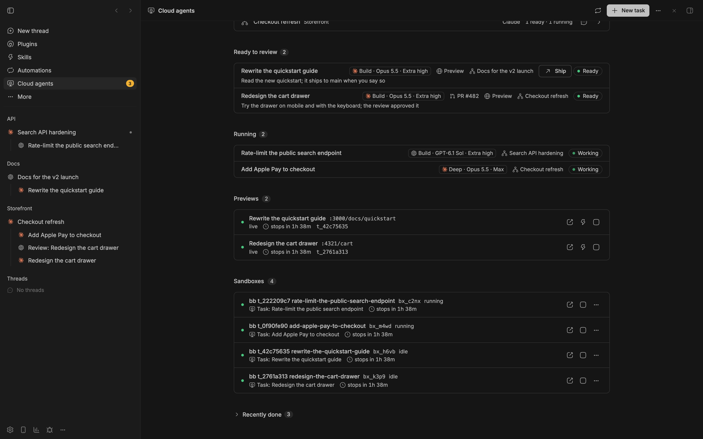
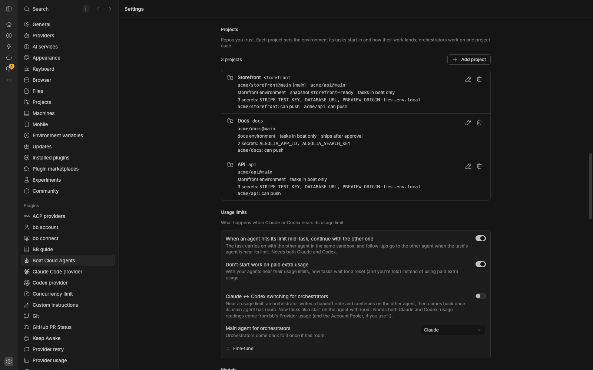
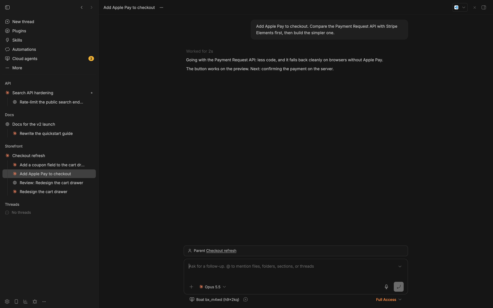
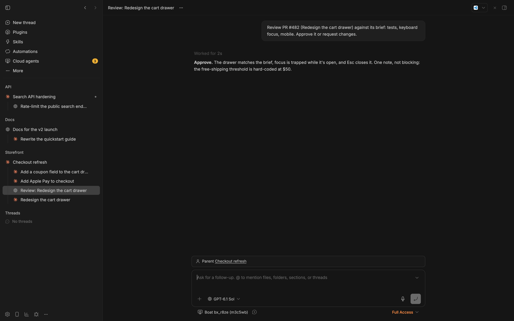

# Features

Everything Boat Cloud Agents does, section by section. To get started, see
the [README](../README.md); for every setting, [settings.md](settings.md);
for orchestrators, [orchestrators.md](orchestrators.md).

## The Cloud agents page



The page has three tabs:

- **Today:** counts, work that needs you, starting points, running work and
  a timeline. Task links lead back to their chats when available.
- **Sandboxes:** the chats using each sandbox, its measured size where
  available, state, and confirmed Resume, Stop and Delete actions. Weekly
  hours and cost remain unavailable when the plugin has no figures.
- **Projects:** project cards with add and edit sheets for repos, base
  branches, how work lands, sandbox size and the other project settings.

The header's **Start** opens bb's New thread screen. New users get starters;
the setup checklist is also available in the plugin's settings. The sidebar
badge counts work that needs you.

Task chats have a **Task** side-panel tab with **Overview**, **Reviews**,
**Transcript** and **Sandbox**. It shows the brief, report, branch and links,
recorded reviews, searchable transcript, measured memory and sandbox actions.
Chat transcripts use bb's own read-only log; the headless transcript contains
the messages and tool names Boat reports. The plugin does not invent test
results, git totals, memory samples or costs when they are unavailable.

Source chats keep a **Cloud agents** tab for the work they started. A task
that still runs headless has its existing detail page and reply box, with
**Continue as a chat** when supported. See [How tasks
run](#how-tasks-run-in-boat-or-as-task-chats).

The sidebar footer's Boat icon opens sandbox meters: sandboxes on, plan
hours remaining when reported; today's cost is currently unavailable. Only failures
are listed below the meters; an idle stopped sandbox is neutral. **All
sandboxes** opens the Sandboxes tab. Agent usage stays in bb's usage widget.

## Start from anywhere in bb

- **Any chat:** ask it to use a cloud agent. The `boat` skill teaches it
  `bb boat task start`. The chat gets a `[boat]` message when the task's
  turn ends, so you don't need to watch it.
- **The send menu:** **Send to a cloud agent** in an existing chat sends
  your message with a request to use one. On bb's New thread screen,
  **Start** and **Start as orchestrator** submit the native composer.
- **The environment menu:** **Boat sandbox** runs a whole chat in a
  sandbox, with a size chip next to it. Sizes your plan can't use are
  greyed out with boat's reason.
- **A task chat's header/context card:** an action suited to its state,
  such as Ship, Resume or Merge PR. Merge and Ship open an in-thread form;
  submitting the approval triggers fresh source checks before the action.
- **A chat's menu:** **Coordinate from this chat…** makes it the
  orchestrator for a project.
- **bb's home screen and + menu:** starters for checking a repo, fixing a
  bug, and exploring a plan. The old **Start a cloud task** panel is no
  longer a primary entry point.

## New task

Start on bb's **New thread** screen. Pick the project and **Boat sandbox**
environment, then write the brief. The Boat chip exposes the available
sandbox sizes and snapshots. In the send menu, choose **Start** for one task
or **Start as orchestrator** to coordinate the project. The + menu inserts
a brief starter: **Check the repo runs**, **Fix a bug**, or **Explore and
plan**. A starter fills the draft; it does not launch work until you submit.

bb keeps control of the selected project, environment, provider, model,
effort, draft and provisioning. Boat registers the resulting chat as a task;
it does not launch a second worker or replace bb's sandbox ownership.
Registering an existing chat does not establish its checkout branch, so
direct shipping is not offered for that adopted record.

Delegated work still uses `bb boat task start` and **How tasks run**. The
default is headless in boat; `--chat` requests a task chat for trusted repos,
and `--headless` requests the fallback explicitly. **Run a test task** remains
in setup for the repo-free setup check.

A good brief has the goal, the context (files, issues, earlier decisions),
the constraints, how to check the result, and anything special about the
pull request. The plugin adds the
checkout, the push rules and a report block at the end of the agent's
answer, and tells the agent to treat what it reads as data, not
instructions.

## Projects

A project is one or more GitHub repos, each with a base branch, plus the
boat environment its tasks start in. Single tasks don't need one, but a
project lets you set things once per repo, and every orchestrator works on
one. New installs start with none.



- Add one on **Cloud agents → Projects** (also linked from settings), or:
  ```sh
  bb boat project add --name "Web app" --repo acme/web@main --environment web
  ```
  Repeat `--repo` for more repos; the first is the main one, and tasks
  clone the others next to it.
- Per project: the boat environment, a snapshot tasks start from, the
  [sandbox size](#sandbox-sizes-and-memory) its tasks use, how work lands,
  **Run tasks as chats**, protected branches, instructions added to each
  task's brief, and an orchestrator rules file in its main repo.
- Choose Codex, Claude or No review for a project. A native task's explicit
  drawer choice overrides that preference; an unset project uses the global
  review default. Automatic native reviews wait for a reported PR and verify
  its branch and HEAD before dispatch and before publishing a verdict.
- From the command line:
  ```sh
  bb boat project set web-app --protected-branches "release, develop" --instructions-file house-rules.md
  ```
  `none` clears protected branches, instructions or the sandbox size.

## How tasks run: in boat, or as task chats

**How tasks run** decides what a task's agent is:

- **In boat** (default): headless in boat. You follow it on the Cloud
  agents page (transcript, report, reply box). No bb runs in the sandbox,
  and bb Connect isn't needed.
- **As chats for projects:** tasks on repos of projects with **Run tasks as
  chats** on are bb chats on their sandbox, nested under the chat that
  started them. Other repos still run in boat (with an "Untrusted repo"
  badge).
- **As chats everywhere:** every task is a task chat, unless its project
  has **Run tasks as chats** off.

A task becomes a chat only if every repo it clones may: a project's other
repo that's also in a project with **Run tasks as chats** off makes its
tasks headless (the task's history says so). A review runs the
way its task does, except that a task you made a chat against these rules
gets headless reviews. A sandbox that runs bb, or had it installed, takes
no repo these rules would run headless, not even for a headless task.

Open a task chat to watch every step or write to it; the plugin treats your
turn as part of the task. Ultracode (Claude) and Ultra (Codex) work there.
Task chats need bb Connect and take about a minute longer to start. Their
sandbox holds bb machine credentials, so keep them for repos you trust.

**Continue as a chat** on a headless task's page moves the task into a
task chat once its turn has ended. bb is installed on the task's sandbox
(about a minute; a stopped sandbox starts first), and a chat with the same
agent opens there, working in the task's checkout, with the brief, the
latest report and the messages so far (in a file outside the repo, so it's
never committed). The headless conversation stops, follow-ups go into the
chat, and the chat's first turn only reads up and sums up where the task
stands. There's no way back; the Transcript tab keeps the headless
conversation under "Before the move". If a step fails, the task stays
headless and its history says why.

- For repos How tasks run and your projects would run headless (the
  task's own, or one another task ran in that sandbox before), the dialog
  names them, and you tick "I trust …" first.
- The button is greyed out, with the reason under it, while the turn runs
  (wait for it to end, or **Interrupt** it), without bb Connect, while
  another open task shares the sandbox, or once the sandbox is gone.
- It isn't there for a sandbox the plugin didn't create, or one where
  another chat's bb runs: start a new task with Run as a chat instead
  (`--context-from <id>` gives it this one's brief and report). Nor for a
  review in its open task's sandbox: close that task first, keeping its
  sandbox.

From the command line, `bb boat task start` takes `--chat` or `--headless`
(what Run as a chat sends), and `bb boat task continue-as-chat <id>` moves a
task. `--headless` always works, apart from the sandbox rule above. `--chat`
and `continue-as-chat` need bb Connect and work only where these rules would
make the task a chat anyway: agents run the CLI, so for any other repo
they're refused and you decide on the task's page. Native starts are a
separate bb-owned chat flow, not a request to bypass those delegated-task
rules.
Orchestrators' `boat_dispatch` can ask for headless, never for a chat. The
confirm in the dialogs is a step in the UI, not a security boundary: an
agent that already has bb access could send it too (see
[SECURITY.md](../SECURITY.md)).

Idle sandboxes stop on their own: once a task's agent has finished and
waited **Stop idle sandboxes after** (an hour by default), its sandbox
stops. Their files and agent conversations survive and resume on the next
follow-up; anything the agent kept in memory or `/tmp` doesn't. Closing a
plugin-created task deletes its sandbox, unless another open task uses it.
Tracking a native chat does not transfer its machine lifecycle from bb.

Work still running counts, background jobs included. A chat whose turn has
ended while work it started still runs (a background command, a bb
workflow, background agents, a child chat working elsewhere) keeps its
sandbox on: the idle stop waits, **Make room at your sandbox limit** picks
another sandbox, and a task chat's turn stays open while its workflow
runs. Every chat on the machine counts, not only the task's. A headless
task whose agent has finished counts too while processes it left are
still computing (`boat ps`: the same program busy in two readings a few
minutes apart; after a first one, the idle stop waits for the second, and
making room leaves it alone either way). boat's, bb's and the system's
own processes there never count. Background work keeps a sandbox on for
12 hours at most.

Every background command counts, whatever it does or how it's described:
a dev server or a watcher left running in the background keeps its sandbox
on too, up to those 12 hours. Stop one when it's no longer needed, or start
servers detached, as the briefs ask; a detached server keeps its sandbox on
only while its preview is live, under the [preview rules](#previews).

boat's own auto-stop (**Hard stop after**, within your plan's cap) only
sees boat's headless agents at work, not a chat's. While a turn runs in a
task chat, or in any chat on a Boat sandbox (a cloud orchestrator, a chat
you started there), or background work runs there, the plugin moves that
stop out shortly before it comes, by up to Hard stop after (within the
cap). The task's history says "Kept the sandbox on while the agent works",
once a turn. A sandbox with nothing running is never kept on: it stops
when idle, as above. Waiting isn't working either: a chat waiting for a
slot, for a retry after a usage limit, for its machine, or on you (after
one more extend) lets bb suspend the machine, and your next message
resumes it. A turn is kept on for 12 hours at most. When the plugin isn't
keeping a sandbox on, it has bb suspend the machine before boat's stop
comes (a live preview goes then too), so bb knows and resumes it on the
next message. It never suspends a machine while something else works in
its sandbox (a headless agent, a ship), or one bb has just lost the
connection to (bb restarting its daemon there).

### The watchdog

A plain check from the bb machine, no AI, about once a minute (every 30
seconds while a task runs, and at once when a message is queued for a
machine that's offline):

- **A stop behind bb's back.** When boat stops a chat's sandbox itself
  (its auto-stop, a crash, the boat.dev dashboard), bb would keep the
  machine as running and queue every message as "Waiting for … to be
  ready". The plugin suspends the machine through bb to match, so the next
  message resumes it.
- **Messages waiting on a stopped machine.** A suspended machine with a
  message waiting for it is resumed once the message has waited about a
  minute, if bb hasn't resumed it already. Messages held for later on purpose (a retry at a usage
  limit's reset, a slot under bb's limits) don't count.
- **One `[boat] Watchdog:` message per incident** to the task's
  orchestrator, with what happened and what the plugin did:
  - a task's or orchestrator's sandbox stopped while background work was
    running (and what ran), a headless task's included: one whose
    finished agent left processes computing;
  - a chat's messages waited more than 3 minutes on a stopped or
    disconnected machine (10 while bb is resuming it), and whether the
    plugin resumed it. An orchestrator whose own messages are stuck can't
    read a message: you get a phone or desktop notice instead;
  - a running turn showed no new transcript activity for 30 minutes (it
    may be stuck; the plugin leaves it running).

  Nothing for a normal stop (the idle stop after a finished turn with
  nothing in the background).
  Each incident goes out once, even across restarts, and waits while an
  orchestrator is handed over to its successor.
- **The worker hears about it.** After a stop that cut off background
  work, the worker's next message, however it arrives, starts with a short
  note: when it stopped, that its background jobs and `/tmp` were lost,
  and to rerun what it still needs now. The plugin's own follow-ups carry
  it in their text. A message you or the orchestrator type in the task
  chat gets it as a note for the agent in front of it; a message going
  straight to the worker waits 10 seconds once for that. Each stop gets
  its own note, so a second interruption is told too. After a stop at
  the 12-hour limit, the note says the job may have been stuck instead.



## How work lands: pull requests, or ship after approval

Each project picks one (Projects → "How work lands", or
`bb boat project set <id> --delivery pr|push`):

- **Draft pull requests** (default): the agent pushes its own branch and
  opens a draft pull request against the base branch. You merge it on
  GitHub.
- **Ship to the base branch after I approve:** the agent only commits, in
  its sandbox. A git hook refuses its pushes to GitHub, so nothing gets
  there until you approve. Reviews run in the task's sandbox, where the commits
  are. Then you ship:
  - **Ship** on the task's page, card or task chat header opens a confirmation
    in the task chat (or the chat that started it). Check the recorded review
    and measured commit count, then choose **Ship to main** or **Not yet**.
    A note never grants approval. **Not now** cancels without shipping.
    If the work changes while the form waits, request a fresh confirmation.
    Uncommitted changes must be committed before the form can open.
  - Or tell the orchestrator in its chat; it calls `boat_ship`. The plugin
    only ships from the task's own orchestrator chat, after the latest turn
    was reported there and you wrote in that chat since. An agent claiming
    you approved isn't enough.
  - The plugin rebases the commits onto the latest base branch and pushes.
    It never forces. Uncommitted changes, files the agent never added, or
    conflicts stop it before anything is pushed. Then the task closes and
    its sandbox is deleted, unless another open task (its review, say)
    still uses it; the message after Ship or Close names that task.
  - A conflict names its files and the commits on the base branch that
    changed them (and the task that shipped one, when it was one of yours).
    The task's agent rebases and resolves it in a follow-up. That changes
    the work you approved, so you approve again: after that turn, the
    task's page and the orchestrator's notice show **What changed since you
    approved** (`git range-diff` of the commits you approved and the new
    ones, or the changed files where that doesn't work). Until you write in
    the orchestrator's chat again, its `boat_ship` is refused and says why.
  - Until it ships, the sandbox holds the only copy. Closing or cancelling
    such a task asks you to discard the work, and `bb boat sandbox delete`
    refuses. A task with nothing to ship closes like any other. boat deletes stopped sandboxes after 14 days, so after 10 days
    you get a Needs-you question.

## Reviews

**Request review** (on a task's page, in a task chat's header, or
`bb boat task review <id>`) starts an independent review in a fresh context.
With both agents it runs on the other one: **Agent for reviews** (Codex by
default), or the other agent when the task already ran on that one. With one
agent, the same agent reviews. The review reports a verdict and its
findings; send them back with a follow-up.

A running chat-backed review nests under the task it reviews. After a
verdict lands, that review chat is archived and its result stays in the
task's live review card and Reviews tab. Headless reviews remain available
through the recorded report.



## Live cards and notifications

Assistant messages can include Boat's directive markers to show live task
lists, task chips, review verdicts, ready results, decisions and problems.
The plugin reads their current data; the marker does not turn an assistant's
claim into approval or a verified check.

Decision cards keep the message box free. **Go with …** queues the selected
answer with a short **Undo** window before dispatch. **Answer in your own
words** fills the composer so you can add context. Shipping uses its separate
in-thread confirmation because it changes the base branch irreversibly.

Status words are **Working**, **Review**, **Ready** and **Shipped**, with
**Needs you** and **Broken** for interruptions. An idle stop and waiting for
a usage reset are neutral. With **Notify my devices** enabled, push defaults
to needs-you and ready work. Progress is a separate working opt-in, off by
default. Tapping the notification opens the chat;
it does not approve shipping or answer a decision.

## Current limits

- Native starting tracks the chat bb already provisions, preserving its
  selected provider and core-owned machine lifecycle. It does not create a
  second worker. Checkout branch facts may be unknown, so adopted native
  records do not offer direct shipping.
- Headless execution remains a fallback. There is no passive chat
  create/append integration that guarantees every headless task has a
  populated native chat transcript.
- The Task panel's width, icon-only native tab strip, header button styling
  and additive Parent context item are controlled by bb.
- Digest and handoff renderers are not an automatic last-seen digest or a
  guaranteed handoff summary for every switch.
- Usage comes from bounded Boat readings; task costs on shared sandboxes
  cannot be attributed perfectly. Memory charts show measured samples only.
- Native cold starts wait when usage is exhausted or cannot be verified.
  bb's explicit **Send now** overrides dispatch hooks and may use paid extra
  usage; it is separate from Boat's guarded delegated paid-start confirmation.
- The automated test suite uses a fake CLI, not a real paid sandbox run.

## Protected branches

Delegated tasks never push to `main`, `master`, the task's base branch, the base
branch any of your projects uses for that repo, a project's protected
branches, or the branches in **Extra protected branches** (Advanced). The
plugin refuses delegated tasks that point at one, and a git pre-push hook
in plugin-prepared task checkouts enforces it. Native chats retain bb's own
checkout behavior; registering one does not retrofit that hook. Pushes to a folder inside the sandbox (say, a
temporary remote your repo's own tests create) are let through: they can't
reach GitHub.

The hook is a guard for well-behaved agents, not a security boundary. For
hard enforcement, protect your base branches on GitHub.

## Previews

Agents leave a preview running when their change shows in a browser, and
report it in their report block:
`PREVIEW: port=4321 path=/settings cmd="npm run dev -- --host 0.0.0.0 --port 4321"`.

- The plugin runs `boat host <sandbox> <port> --private` and keeps the link,
  port, page and command. Private links carry a token (`?_token=…`): the
  first visit sets a cookie and opens the page, so the link works in any
  browser. Nobody without the link gets in.
- Previews show as **live**, **sleeping** (the sandbox stopped, or the
  server isn't running) or **expired** (the sandbox is gone), with the time
  left before auto-stop. The Cloud agents page lists live and sleeping
  ones; expired ones stay on their task's page.
- **Wake** resumes the sandbox, restarts the stored command, hosts the port
  again (same link) and opens it. **Extend** keeps the sandbox on 2 more
  hours (at most your plan's auto-stop cap). **Stop** stops the sandbox.
- A sandbox with a live preview whose task waits on you isn't stopped as
  idle, and it's the last one stopped to make room.
- `bb boat preview list | wake | extend | stop`, and `boat_preview` for
  orchestrators.

## Sandbox sizes and memory

Sandboxes come in four sizes: Small (2 vCPU, 4 GB), Default (4 vCPU, 8 GB),
Large (8 vCPU, 16 GB) and XLarge (16 vCPU, 32 GB). What each costs, and
which the trial allows, is under [Costs](../README.md#costs). Size pickers
grey out the sizes your boat plan doesn't include, with boat's reason.

- **Which size a delegated task's sandbox gets:** its `--type`, else its project's **Sandbox size**,
  else the **Default sandbox size** setting. The project is the task's own,
  or the one whose main repo the task works on. Reviews in a new sandbox
  use the project's size too, and at least the size of the task they
  review (as boat reports it; XLarge only with your OK).
  - A size picked for a task that your plan doesn't include is refused
    before anything starts. A project size it doesn't include falls back to
    the setting (or a smaller size the plan has), the task's history says
    so. Native starts instead use the Boat size chip in bb's composer.
  - Set a project's size in Cloud agents → Projects → **Sandbox size** ("Same
    as the setting" is the default), or:
    ```sh
    bb boat project set web-app --size large     # none: back to the setting
    ```
    `bb boat project list` shows it ("large sandboxes"), and backups
    include it.
- **Agents know their size.** Every task's first prompt, review prompt and
  handover says the sandbox's size, CPUs and memory (read inside the
  sandbox, new or reused), that other processes share it (other tasks'
  checkouts, preview servers, and in a task chat bb itself), and to run
  heavy test suites one at a time, not all at once. After the sandbox
  moves to another size, the next follow-up says the new one.
- **Out of memory.** When a turn fails, is cut off, ends without a new
  message or stops though nobody interrupted it, the plugin checks the
  sandbox for out-of-memory kills during that turn: the kernel's log, and
  its count of such kills. The check runs in the background with a short
  time limit, and never starts a stopped sandbox.
  - When the kills ended the turn, the task's error says so first, for
    example "The sandbox ran out of memory: the system stopped a 1.4 GB
    process in the task chat (MainThread). That restarted bb on the sandbox
    and ended the chat's turn. Run fewer tests at once, or continue on a
    larger sandbox." The original error stays below it (**Original error**
    on the task page). Otherwise the original error comes first, and the
    out-of-memory line follows it.
  - The history lists what was stopped. `bb boat task show` shows the
    sandbox's size and the command to continue on the next size, and the
    orchestrator's `[boat]` notice says what to do.
  - When the kernel's log can't be read, a higher count only means the
    sandbox may have run out of memory: the history and the notice say
    that, and the error stays as it was.
  - These facts are read inside the sandbox, where the agent has full
    access: treat them as a strong hint, not proof. They never move a
    sandbox on their own.
- **Continue on a larger sandbox.** After an out-of-memory failure, the
  task page offers **Continue on a larger sandbox…** and, for a project's
  task, **Use Large for Web app from now on** (the next size up; XLarge
  asks first). Between turns, **Change size…** next to the sandbox in the
  task's details moves it to any size.
  - The dialog preselects the next size up your plan has (after running out
    of memory only), says what the size costs next to the current one, and
    warns when other open tasks share the sandbox (they move too), when
    previews stop (**Wake** starts them again), when a smaller size might
    not fit and when few boat starts are left. The message is prefilled,
    for example "Continue where you left off. The sandbox is now Large
    (8 vCPU, 16 GB). Run heavy test suites one at a time."; leave it empty
    to only change the size.
  - It's refused while a turn of any open task on that sandbox runs, and
    for sandboxes the plugin didn't create.
  - The move: the sandbox stops and resumes on the new size (one boat
    start; files stay, running processes stop). Once it's up (and, for task
    chats, bb has reconnected to it), every task on it gets a history line,
    and your message goes to the agent. If boat refuses the size (it won't
    shrink a sandbox whose data doesn't fit), the sandbox goes back to its
    old size. Either way the task stays usable, with a note on what
    happened.
  ```sh
  bb boat task followup t_1a2b3c4d --type large --message "Continue where you left off."
  bb boat sandbox resize bx_k3p9 --type large    # only the size
  ```
- **Orchestrators and agents.** Orchestrators move a sandbox with
  `boat_followup` and `sandbox_size`; `bb boat task followup --type` and
  `bb boat sandbox resize` from an agent's chat have the same limits.
  Without your OK they move it only one size up, only after its task's
  latest turn ran out of memory (or came near the limit on a measured
  turn), and never when another chat's tasks share it. Anything else needs
  your OK (`user_approved`, `--user-approved`).
- **XLarge always needs your OK:** a new XLarge sandbox
  (`--type xlarge`, `boat_dispatch` with `machine_type: "xlarge"`), a move
  to XLarge (from the command line too), and XLarge for a project set from
  an agent's chat. On the page, picking XLarge is the OK.
- **Measure instead of guess.** "Check this repo runs in a sandbox" (and
  the test task, or `bb boat task start --measure-memory`) samples the
  sandbox's memory in use every second during its first turn. The plugin measures it, not the agent (page cache doesn't
  count; swap does). The finished task shows the peak and a recommended
  size, for example "Peak memory: 6.1 of 8 GB. Recommended size: Large."
  The rule: the next size up when the peak reached 75% of the sandbox's
  memory or something was stopped for memory, else the same size (on
  XLarge: run fewer tests at once). A size your plan doesn't include says
  so. For a project's repo, **Use Large for Web app** sets the project's
  size; without a project, pick a size in the Boat chip for the next native
  time. When other tasks used the sandbox meanwhile, the page says part of
  the peak is theirs.

## Snapshots

- Start sandboxes from a saved snapshot: set it on a project, or pass
  `--snapshot <name>` to `bb boat task start` (`none` starts fresh).
- **Save as snapshot** on a finished "Check this repo runs in a sandbox"
  task, or `bb boat sandbox snapshot <id> <name>`, saves one;
  `bb boat sandbox snapshots` lists them with your plan's allowance.
- Sandboxes that run bb (task chats and cloud orchestrators) can't be
  saved: their disk holds bb's login.
- A missing snapshot, or a plan without snapshots, gets a plain message
  instead of boat's raw error.

## Environments, secrets and GitHub access

Tasks start in a **boat environment**: the repos it clones, the variables
and secret files it injects, and whether your GitHub and AI logins go in.
Empty **Boat environment** uses your boat default; a project can pick its
own.

- **Create one and add secrets** on the boat.dev dashboard, or with the boat
  CLI: `boat env new web`, then `boat env set-var web KEY` (the value comes
  from stdin, so it stays out of your shell history), and
  `boat env set-file web .env.local --from ./my.env` for files. Running
  sandboxes keep the old version until `boat env upgrade web`.
- **"Safe for third parties"** hides your agent logins and GitHub from
  sandboxes. While it's on, the setup check fails and tasks don't start;
  turn it off on boat.dev → Environment or with
  `boat env set <name> --safe-for-third-parties false`.
- **Secrets by name only.** The plugin shows an environment's secret names
  (project settings, `bb boat status`). It drops the values as soon as it
  reads `boat env info`, so it never puts them in the UI, the logs or a
  chat. Agents can still read them in their sandbox: that's what the
  environment is for.
- **boat credentials and AI keys.** An environment can pass boat
  credentials (the boat CLI's login, for your whole account) into
  sandboxes: workers there could start, stop and delete any of your
  sandboxes. The plugin doesn't need them there. The setup checklist warns
  ("boat login in sandboxes") while an environment your workers use passes
  them; turn them off with `boat env set <name> --boat-credentials false`.
  A project's access line warns too. It also notes when real AI keys go in:
  the AI proxy (`boat ai proxy on`, a paid boat add-on: `boat ai proxy`
  shows the price) passes placeholders instead. When boat doesn't say
  whether an environment passes boat credentials, both say they couldn't
  tell. None of this stops a task. More in
  [SECURITY.md](../SECURITY.md#trust-model).
- **Repo access.** Before a task starts, the plugin asks GitHub from inside
  the sandbox what boat's login may do with each repo. No access stops the
  task with "Connect GitHub on boat.dev → Environment and give boat access
  to this repo". Read-only access is enough for reviews, not for tasks that
  push. The last result per repo shows in the project settings and
  `bb boat status`; the setup checklist shows the newest one.
- **Expired GitHub logins.** boat gives sandboxes a GitHub token that lasts
  about 8 hours. Before a follow-up that needs GitHub (a push, a pull
  request) or a ship, the plugin checks it. An expired one is reported with
  what to do: `boat env upgrade <name>` to refresh running sandboxes, or a
  new task.

## Screenshots and recordings

A task's sandbox is deleted when the task closes, so agents upload their
screenshots and recordings before they finish. This is off by default. Turn
it on in Settings → Advanced → **Screenshots and recordings**
(`evidenceUploader`):

- **Off** (empty, the default).
- **Built-in uploader** (`builtin`): the uploader that ships with the plugin
  (`assets/evidence-upload.mjs`). It has no dependencies, needs Node 20+ in
  the sandbox, and uploads to any S3-compatible bucket (Cloudflare R2, AWS
  S3, MinIO and others).
- **Your own script** (`owner/repo:path[@ref]`): fetched from GitHub with
  the bb machine's `gh` login. Pin it to a commit (`@<commit sha>`), so a
  later push to that repo can't change what runs in your sandboxes.

Every task sandbox then gets an `evidence-upload` command. Agents run
`evidence-upload <files or folders> --name <short label>`. It prints one
link per file, and they paste the links into their report (with an
`EVIDENCE:` line in the report block). `evidence-upload --link <key>` prints a
fresh link for a file already uploaded, and `--help` shows all options of
the built-in uploader.

The built-in uploader reads its configuration from environment variables.
Set them in your boat environment, never in the plugin settings:

| Variable | Needed | Meaning |
| --- | --- | --- |
| `EVIDENCE_BUCKET` | yes | Bucket name |
| `EVIDENCE_ACCESS_KEY_ID`, `EVIDENCE_SECRET_ACCESS_KEY` | yes | Keys with write access to the bucket. `EVIDENCE_R2_ACCESS_KEY_ID` / `EVIDENCE_R2_SECRET_ACCESS_KEY` and `AWS_ACCESS_KEY_ID` / `AWS_SECRET_ACCESS_KEY` work too |
| `EVIDENCE_ENDPOINT` or `CLOUDFLARE_ACCOUNT_ID` | for R2 and other S3 services | The S3 endpoint URL. With only `CLOUDFLARE_ACCOUNT_ID`, it's `https://<account id>.r2.cloudflarestorage.com`. Without either, AWS S3 (`https://s3.<region>.amazonaws.com`) |
| `EVIDENCE_REGION` | no | Default `auto` for R2, else `us-east-1` |
| `EVIDENCE_LINK_DAYS` | no | How long links work, 1–7 days (default 7) |

For example, for Cloudflare R2:

```sh
boat env set-var web EVIDENCE_BUCKET
boat env set-var web EVIDENCE_ACCESS_KEY_ID
boat env set-var web EVIDENCE_SECRET_ACCESS_KEY
boat env set-var web CLOUDFLARE_ACCOUNT_ID
bb boat config set evidenceUploader builtin
```

- Keep the bucket private. Links are presigned: anyone with a link can open
  that file until the link expires.
- The task history says which variables a sandbox is missing (names only).
  A failed install never stops a task; the agent then reports that uploads
  failed.
- When a report mentions screenshots or recordings without links, an
  orchestrator asks the agent to upload them before closing the task
  (`boat_followup` with `evidence_only`, or
  `bb boat task followup <id> --evidence-only`).
- `bb boat task show` lists every link a task's turns uploaded.

## Coding agents and usage limits

**Coding agents** is on Auto-detect by default: the plugin reads which
Claude and ChatGPT logins are connected in boat.dev for the environment new
sandboxes use. With one agent, every task and review runs on it (reviews
still run, in a fresh context), and switching agents is off. Pick by hand
(Claude and Codex, Only Claude, Only Codex) if bb's Account Pooler logs your
task chats in instead. When your choice disagrees with boat.dev, the setup
checklist warns and offers **Use Auto-detect**.

- **Don't start work on paid extra usage** (on by default): delegated new
  work is persisted when the current usage reading shows its selected agent
  at the configured limit. No task or sandbox is allocated
  while waiting. The queue survives reloads, and cancelled or stale source
  requests cannot start later. Chats already running carry on.
- **Start now on paid usage…** opens an in-thread confirmation for one
  queued request. It defaults to Wait and rechecks the request, project,
  settings, provider and usage before insertion. It does not enable a
  global billing setting or approve other queued requests.
- Native cold starts use bb's own waiting message queue. Its explicit
  **Send now** action bypasses dispatch hooks by core design and may use
  paid extra usage. This native override is separate from the delegated
  paid-start form.

With both agents:

- Delegated tasks start on **Agent for tasks** (Claude Code by default), and
  reviews run on **Agent for reviews** (Codex), so each change gets a
  second opinion from the other model.
- **When an agent hits its limit mid-task, continue with the other one** (on
  by default): the task carries on with the other agent in the same
  sandbox. A follow-up also goes to the other agent when the task's agent
  is at or above **Switch at** (90% by default) and the other has room; a
  review does when the agent picked for it is. The task history says so, for example "Claude is at 95% of its
  limit; continued with Codex". This never happens when you or an
  orchestrator asked for a specific agent (by name, a model, or an effort
  level only one agent has), and steers stay with the running agent.
- **Claude ↔ Codex switching for orchestrators** (off by default) moves an
  orchestrator to the other agent near a limit. See
  [Orchestrators](orchestrators.md#claude--codex-switching).

Usage readings come from bb's Provider usage (the Account Pooler for the
agents it routes, else the Claude Code and Codex providers). Reading them
costs no tokens. When any chat on this bb fails on a usage limit, that agent
counts as full until the limit resets. `bb boat relay status` shows each
agent's usage.

## Model presets

A task can run with a model preset: Light, Review, Build, Deep or Frontier
(`--tier` on the command line). The preset picks the model and effort for
the task's agent, and the plugin records preset, model, effort and the
reason on the task. Orchestrators always pick one. Edit the table in
Settings → Advanced → Model presets when model ids change.

Native starts keep the model and effort selected in bb's composer; they do
not replace that selection with a task preset.

| Preset | Claude | Codex | Use for |
| --- | --- | --- | --- |
| Light | claude-sonnet-5-5 · high | gpt-6.1-sol · medium | Mechanical or exactly specified work |
| Review | claude-opus-5-5 · high | gpt-6.1-sol · high | Reviews and audits; small fixes with a known cause |
| Build | claude-opus-5-5 · xhigh | gpt-6.1-sol · xhigh | Normal implementation and debugging |
| Deep | claude-opus-5-5 · ultracode | gpt-6.1-sol · ultra | Parallel exploration plus independent checking |
| Frontier | claude-fable-5-1 · xhigh | gpt-6-astra · xhigh | Only after Deep fell short |

- Without a preset, tasks use **Model for tasks** and reviews **Model for
  reviews** (Settings → Advanced); empty means the Build and Review presets.
- Tasks in boat can't use Ultracode or Ultra, so there Deep runs at max and
  the brief asks Claude to use helper agents.
- Model ids are bb's (`claude-opus-5-5`); tasks in boat get boat's
  (`opus-5-5`).
- Frontier at max, Ultracode or Ultra is refused unless you approved it
  (`--user-approved`).
- A follow-up keeps the task's preset.

## Commands

Everything is available as `bb boat …`, from any chat or terminal. Every
command has `--help`, and `--json` gives machine-readable output.

| Command | Purpose |
| --- | --- |
| `bb boat doctor` | Check the setup, with a fix for each problem; never starts a sandbox |
| `bb boat status` | Setup summary, plan limits, sandboxes, open tasks, repo access |
| `bb boat task start --test` | Start the test task: no repo, changes nothing |
| `bb boat task start --title … --brief …` | Start a task (`--repo`, `--project`, `--agent`, `--tier`, `--snapshot`, `--sandbox`, `--type`, `--chat` or `--headless` …) |
| `bb boat task continue-as-chat <id>` | Move a headless task into a task chat (repos the rules trust; others from the task's page) |
| `bb boat task review <id>` | Independent review of a task's work |
| `bb boat task followup <id> --message …` | Next turn (`--agent` switches agent, `--tier` changes preset, `--steer` redirects a running turn, `--type large` moves its sandbox to another size first) |
| `bb boat task show \| transcript \| list \| interrupt \| close` | Inspect and finish tasks |
| `bb boat task ship <id>` | Ship approved work (projects that ship after approval) |
| `bb boat task ready <id> --note …` | Put a task under Ready to review (what `boat_ready` does, for chats without tools) |
| `bb boat decision add \| list \| resolve` | Decisions only you can make, under Needs you (`boat_needs_you`, `boat_resolve`) |
| `bb boat task wait <id>…` | Block until tasks stop running; a last resort: ending the turn is better, the chat is told when a turn ends |
| `bb boat preview list \| wake \| extend \| stop` | Previews |
| `bb boat sandbox list \| new \| info \| stop \| resume \| resize \| delete \| exec` | Sandboxes (`resize <id> --type <size>` moves a task's sandbox to another size) |
| `bb boat sandbox snapshot \| snapshots` | Snapshots |
| `bb boat project list [--local] \| add \| set \| remove` | Projects (`--protected-branches`, `--instructions`, `--delivery`, `--workers`, `--size` …) |
| `bb boat config get [key] \| set <key> <value> \| reset <key>` | Every setting, wherever it's shown ([settings.md](settings.md)) |
| `bb boat config export \| import` | Back up and restore settings, projects, model presets and protocol |
| `bb boat orchestrator new \| on \| off \| list` | Orchestrators ([orchestrators.md](orchestrators.md)) |
| `bb boat protocol show \| path` | The orchestrator protocol |
| `bb boat relay status \| check \| switch` | Agent usage and Claude ↔ Codex switching |

Orchestrators get the same as agent tools (`boat_dispatch`, `boat_review`,
`boat_followup`, `boat_tasks`, `boat_ship` and others). The `boat` and
`boat-orchestrator` skills teach agents how to use them.
