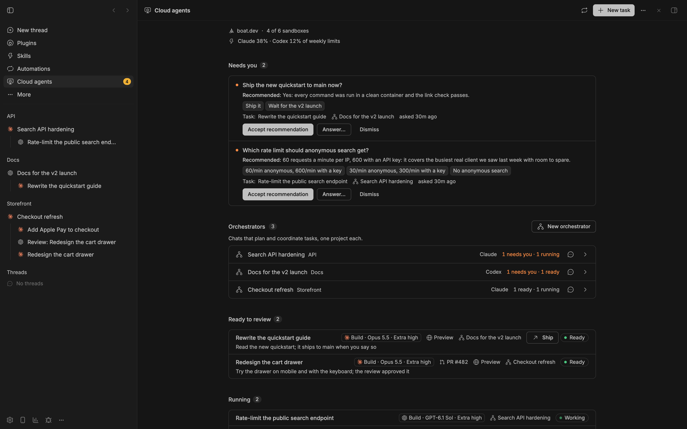
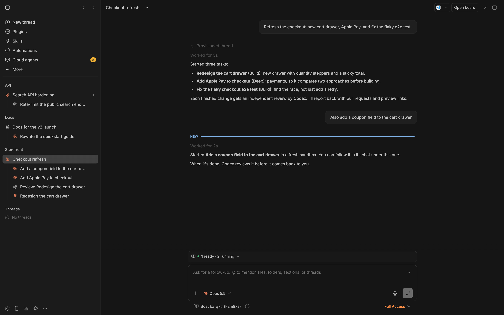
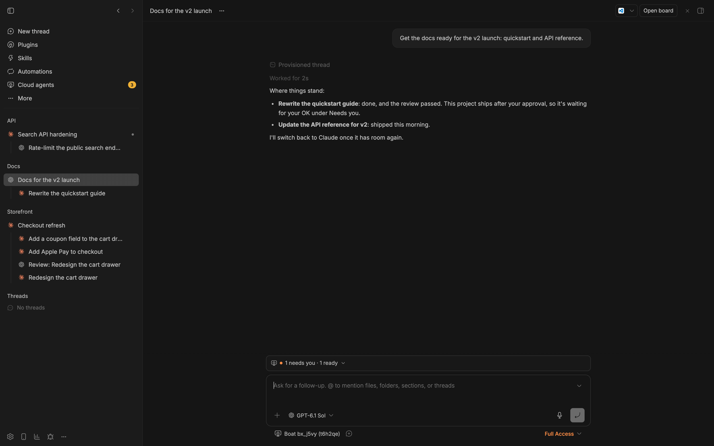

# Orchestrators

An orchestrator is a chat that plans and coordinates tasks for one project.
You tell it the goal. It splits the work into tasks, starts each one in its
own boat sandbox, gets every change reviewed (by the other agent when you
have both), sends the findings back, and brings you only the decisions and
the finished results. It never writes code itself.

Orchestrators are optional. Everything in the [README](../README.md) works
without one.





## When to use one

- **A goal that keeps producing tasks:** a backlog of bugs, a feature in
  several parts, design variants to compare side by side.
- **Reviews without the legwork:** every change is reviewed before it
  reaches you, and the findings go back to the task's agent until the
  review approves.
- **Decisions, not updates:** you answer the questions only you can, and
  look at finished work.

## When a single task is better

- **One fix that fits in one task.** Ask any chat to use a cloud agent, or
  use **Start** on bb's New thread screen with **Boat sandbox** selected.
- **A quick look.** A single task with the "Explore and plan, no changes"
  starter.
- **A tight budget.** An orchestrator uses agent usage and sandbox hours
  faster than single tasks: it starts several tasks, and a review for each.
  It asks you before it runs more than 5 tasks at once (**Tasks at once
  before asking**, under Settings → Orchestrators; 0: it never asks).

## Starting one

1. **Choose a project** on bb's New thread screen. Add its Boat settings on
   **Cloud agents → Projects** or with `bb boat project add` when needed.
   An orchestrator works on one project.
2. **Write the goal** in bb's composer and choose **Start as orchestrator**
   in the send menu. Choose **Boat sandbox** for a cloud chat, or use an
   existing bb environment. bb keeps the environment, provider, model and
   effort you selected; Boat marks that chat as an orchestrator before its
   first turn.
3. **Other entry points** remain available:
   - **New orchestrator…** in the command palette opens the native starting
     flow. The existing project-based dialog/CLI flow also remains for
     explicit placement and take-over options.
   - From a chat you already have: the chat's menu → **Coordinate from this
     chat…**, then pick the project. The orchestrator's tools and
     instructions reach the chat's agent at its next session; the chat
     keeps its own agent, model and effort. **Stop coordinating…** in the
     same menu undoes it (`bb boat orchestrator on --project <id>` and
     `bb boat orchestrator off` do the same).
   - From the command line:
     ```sh
     bb boat orchestrator new --project web-app --prompt "Fix the three open checkout bugs: one pull request each"
     ```

For the existing dialog or CLI flow, pick where it runs: **This computer**
(`--local`), another bb machine (`--machine <host id>`), or **In the cloud**
(a Boat sandbox; `--cloud`, needs bb Connect). Without a choice, it runs in
the cloud when bb Connect is set up, and on this computer otherwise.

Check what it runs as. In the dialog, one line under Where says it, for
example "Claude Code · Opus 5.5 · High effort". Select it to pick another
agent or effort; an unavailable agent has its reason beside it. See
[Agent, model and effort](#agent-model-and-effort).

"Take over from" in the dialog, or `--take-over <thread>`, moves a previous
orchestrator's open tasks to the new one, with its last message.

The Cloud agents **Today** tab brings needs-you work and orchestrators
together, with live cards in the chats where work happens:

- **Needs you:** decisions only you can make, each with the orchestrator's
  recommendation. **Go with …** queues the answer with a short Undo window;
  **Answer in your own words** fills the composer instead.
- **Ready:** finished work with its note, pull request and preview. **Open
  PR** opens GitHub; it does not merge the pull request.
- Source chats have a **Cloud agents** side-panel tab. A task's own chat
  has a **Task** tab: Overview, Reviews, Transcript and Sandbox.
- With task chats, they sit in the sidebar under their orchestrator
  (**Orchestrators in the sidebar**: sections by project, pinned, or no
  grouping).

## Agent, model and effort

Native starts use bb's composer selections. The existing dialog, command
line and take-over flows resolve explicit defaults:

- **Agent:** **Agent for orchestrators** (Claude Code by default), or the
  other one while boat.dev reports it as not connected. With one agent
  (**Coding agents**), always that one.
- **Model:** the agent's Build preset model, the one Build tasks use
  (Settings → Advanced → Model presets). Changing it there changes it for Build tasks too;
  for orchestrators alone, use `--model`.
- **Effort:** **Effort for orchestrators**: Low, Medium, High (the default)
  or Extra high. An orchestrator mostly reads reports, plans and starts
  tasks; the tasks do the heavy work at their own preset. Higher effort uses
  your limits faster, since an orchestrator stays open and wakes after
  every task turn.

Change the defaults in Settings → Orchestrators, or:

```sh
bb boat config set relayPreferred codex       # Agent for orchestrators
bb boat config set orchestratorEffort medium  # Effort for orchestrators
```

For one orchestrator, pick in the dialog, or on the command line:

```sh
bb boat orchestrator new --project web-app --prompt "…" --provider codex --effort xhigh
bb boat orchestrator new --project web-app --prompt "…" --model claude-fable-5-1   # a model picks its agent
```

`--provider` takes `claude-code` (or `claude`) and `codex`, and `--model`
takes boat's ids too (`opus-5-5`); what you name wins over the settings.
The command prints what it started with.

[Claude ↔ Codex switching](#claude--codex-switching) starts an orchestrator
on the other agent, with that agent's Build preset model at **Effort for
orchestrators**. If you picked another effort for one orchestrator, it
keeps it on both agents; a model you named comes back whenever it runs on
that model's agent again.

## Cloud orchestrators

An orchestrator can run in its own boat sandbox instead of on this
computer. It needs bb Connect, so the sandbox can reach your bb.

- It uses one sandbox, Small by default (**Size for chats on a Boat
  sandbox**, which also sizes any chat you start on a Boat sandbox), since
  orchestrators mostly coordinate.
- Setup takes about 1–2 minutes. Claude Code and Codex come preinstalled and
  use the logins connected in boat.dev (or bb's Account Pooler, if it routes
  them).
- Shortly before the sandbox's auto-stop, the plugin extends it if a chat on
  it is busy, and otherwise suspends it. bb resumes it when the chat gets a
  message. The sandbox is deleted once no chat needs it.

### Full access for cloud orchestrators

Cloud orchestrators run with full access in their sandbox, like task chats:
they run unattended on a machine of their own. Off, they use your default
mode for new chats, where Claude Code's sandbox can block the `bb` command.

- This applies to new cloud orchestrators, and to Claude ↔ Codex switching
  that lands in a Boat sandbox.
- Orchestrators on your own machines always keep your default mode.
- Change it in Settings → Orchestrators → **Full access for cloud
  orchestrators**, or:
  ```sh
  bb boat config set cloudOrchestratorFullAccess false
  ```

## Tools first

Orchestrators get the boat tools. Their instructions, the protocol and the
`boat-orchestrator` skill tell them to use the tools for everything the
tools cover, and not the `bb boat` command: the agent's own command sandbox
may block `bb`. `bb boat …` is only for what no tool does.

| Tool | Use |
| --- | --- |
| `boat_protocol` | Load the protocol |
| `boat_status` | Room for more sandboxes |
| `boat_dispatch` | A new task in a fresh sandbox, with a model preset and a one-line reason |
| `boat_review` | An independent review, by the other agent when you have both |
| `boat_followup` | The next turn for the same task; can change the preset or the agent, or first move its sandbox to a larger size: one size up after it ran out of memory, anything else only with your OK ([sizes](features.md#sandbox-sizes-and-memory)) |
| `boat_tasks` / `boat_task` / `boat_transcript` | State, reports, what an agent is doing |
| `boat_interrupt` / `boat_close` | Stop a turn; accept or cancel a task |
| `boat_needs_you` / `boat_resolve` | Put a decision on your Cloud agents page; close it once you answered |
| `boat_ready` | Mark work ready for you to review (after the review approved) |
| `boat_preview` | List previews; wake, extend or stop one |
| `boat_ship` | Projects that ship after approval: push the work to the base branch, only on your OK in the orchestrator's chat |

`boat_ship` only works from the task's own orchestrator chat, after the
task's latest turn was reported there and you wrote in that chat since.
When a ship stops on a conflict, the orchestrator sends the follow-up that
resolves it, then shows you what changed since you approved and asks you to
approve again: your earlier OK doesn't cover the new commits. See
[Ship](features.md#how-work-lands-pull-requests-or-ship-after-approval).

## Claude ↔ Codex switching

Off by default. Turn it on in Settings → Advanced → **Claude ↔ Codex
switching for orchestrators** (`relayEnabled`). It needs both Claude and
Codex.



- Near a usage limit (**Switch at**, 90% of the fullest usage limit by
  default), the plugin asks the orchestrator for a handoff note, then
  starts an orchestrator on the other agent in the same workspace (which
  model and effort: see [Agent, model and effort](#agent-model-and-effort)).
  Open tasks, decisions, task chats and your waiting messages move to it.
- New tasks also start on the agent with room.
- Once the **Agent for orchestrators** (Settings → Orchestrators) is below
  **Switch back below** (50%) again, and the orchestrator has been quiet
  for **Wait before switching back** (10 minutes), it switches back. That
  includes an orchestrator you started on the other agent. After any
  switch there's a 30-minute pause.
- **Switch back below** must be at least 5 under **Switch at**, so
  orchestrators don't bounce between agents.
- Usage readings come from bb's Provider usage (the Account Pooler for the
  agents it routes, else the Claude Code and Codex providers). The check
  runs in bb's background service every minute, so bb must be running.

This still creates a successor orchestrator chat; provider switching in
place is not implemented. The relay can request a handoff note, but the v1
handoff-note card is not an automatic, verified summary of every switch.
Waiting for a usage reset is neutral, rather than needs you. With device
notifications enabled, push is limited to needs-you and ready work.

```sh
bb boat relay status                                  # each agent's usage, and which agent each orchestrator runs on
bb boat relay check                                   # run the check once now
bb boat relay switch [<thread>] [--to claude|codex] [--now]   # move one by hand
```

Tasks have their own rules for limits (continue with the other agent
mid-task, follow-ups to the agent with room): see
[Coding agents and usage limits](features.md#coding-agents-and-usage-limits).

## The protocol

Every orchestrator follows one shared protocol: how to delegate, pick model
presets, run reviews, act on reports and report back.

- Edit it in Settings → Advanced → Protocol.
  It's a Markdown file next to the plugin's database
  (`bb boat protocol path`), so you can also edit it in any editor. Until
  you save one, the built-in protocol applies and follows plugin updates.
  **Reset to built-in** goes back to it.
- A project can add its own rules file in its main repo (for example
  `docs/agents/orchestrator.md`). `boat_protocol` fetches it with the bb
  machine's `gh` login and puts it after the shared protocol. The repo's
  AGENTS.md still applies to tasks.
- Orchestrators load the protocol when they start, after a take-over and
  after context compaction. On every wake they check every open task first,
  so a missed report never stalls work.
- `bb boat protocol show [--project <id>]` prints what an orchestrator gets.

### Placeholders

When an orchestrator loads the protocol, these are filled in from your
current settings. The editor highlights them and warns about unknown ones.

| Placeholder | Becomes |
| --- | --- |
| `{{workers}}` | How tasks run, from **How tasks run** and the project |
| `{{agents}}` | Your agents, usage limits and Claude ↔ Codex switching |
| `{{evidence}}` | What to do with screenshots and recordings (uploads on or off) |
| `{{tasks-at-once}}` | When to ask you before running more tasks at once, from **Tasks at once before asking** |
| `{{model-tiers}}` | The model presets table (Settings → Advanced). A protocol without it gets the table at the end |

The orchestrator picks a [model preset](features.md#model-presets) for each
task, with a one-line reason. The plugin then picks the model and effort for
the task's agent and records all four on the task.
