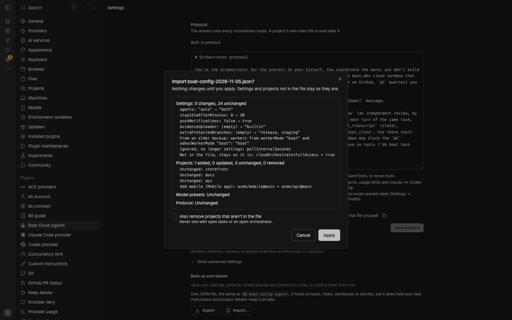

# Settings

Settings → Plugins → Boat Cloud Agents. bb's settings list there has the
everyday choices; the plugin's own sections below it have the rest.
`bb boat config get` lists every setting with its value, and
`bb boat config set <key> <value>` / `bb boat config reset <key>` change
any of them. (`bb plugin config boat set` only reaches bb's list.)

## bb's settings list

| Setting | Key | Default | What it does |
| --- | --- | --- | --- |
| Coding agents | `agents` | `auto` | Auto-detect (`auto`) from boat.dev, or Claude and Codex (`both`), Only Claude (`claude`), Only Codex (`codex`). With one agent, every task and review runs on it |
| How tasks run | `workers` | `boat` | In boat (`boat`), As chats for projects (`projects`) or As chats everywhere (`all`). Chats need bb Connect |
| Boat environment | `environment` | empty | The boat environment new sandboxes start from; empty is your boat default. A project can pick its own |
| Default sandbox size | `machineType` | `default` | `small` (2 vCPU, 4 GB), `default` (4 vCPU, 8 GB), `large` (8 vCPU, 16 GB), `xlarge` (16 vCPU, 32 GB). You can pick another per task |
| Sandboxes at once | `maxActiveSandboxes` | `3` | The most sandboxes running at the same time; 0 is your plan's limit |
| Agent for tasks | `implementProvider` | `claude` | For tasks that don't name an agent. With one agent connected, it runs everything |
| Agent for reviews | `reviewProvider` | `codex` | When a task already ran on this agent, its review uses the other one. With one agent connected, it reviews too |
| Stop idle sandboxes after (min) | `stopIdleAfterMinutes` | `30` | Stops a task's sandbox once its agent has waited this long; 0 is never |
| Notify my devices | `pushNotifications` | off | A notice when a task finishes a turn. Notices about agent switches and usage limits always go out |
| Instructions for every task | `workerInstructions` | empty | Added to every task's brief: house rules, test commands, commit style. Don't put credentials here |

## The plugin's own sections

In this order:

1. **Setup:** the same checklist as on the Cloud agents page, plus
   **Screenshots and recordings**, and **boat CLI location** when the boat
   CLI isn't found.
2. **Projects:** your projects, with their repos, environment, protected
   branches, instructions and GitHub access.
3. **Usage limits:** what happens near a usage limit. The rows that need
   both agents are greyed out with one.
4. **Models:** the model presets, and models for tasks without one.
5. **Orchestrators (optional):** the sidebar, the size of chats on a Boat
   sandbox, full access for cloud orchestrators, and the orchestrator
   protocol. While you've hidden the orchestrator card on the Cloud agents
   page, **Show the orchestrator card again** brings it back.
6. **Advanced** (collapsed).
7. **Back up and restore.**

| Section | Setting | Key | Default |
| --- | --- | --- | --- |
| Setup | Screenshots and recordings | `evidenceUploader` | empty (off) |
| Usage limits | When an agent hits its limit mid-task, continue with the other one | `autoFailover` | on |
| Usage limits | Don't start work on paid extra usage | `avoidExtraUsage` | on |
| Usage limits | Claude ↔ Codex switching for orchestrators | `relayEnabled` | off |
| Usage limits | Main agent for orchestrators | `relayPreferred` | `claude` |
| Usage limits | Switch at (% of a usage limit) | `relaySwitchAt` | `90` |
| Usage limits | Switch back below (%) | `relaySwitchBackBelow` | `50` (at least 5 below Switch at) |
| Usage limits | Wait before switching back (min) | `relayQuietMinutes` | `10` |
| Models | Model for tasks | `implementModel` | empty (the Build preset's model) |
| Models | Model for reviews | `reviewModel` | empty (the Review preset's model) |
| Models | Effort | `reasoningEffort` | `default` (boat's) |
| Orchestrators | Orchestrators in the sidebar | `sidebarLayout` | `sections` |
| Orchestrators | Size for chats on a Boat sandbox | `orchestratorMachineType` | `small` |
| Orchestrators | Full access for cloud orchestrators | `cloudOrchestratorFullAccess` | on |
| Advanced | Hard stop after (hours) | `sandboxTtlHours` | `2` |
| Advanced | Make room at your sandbox limit | `freeSlotsWhenFull` | on |
| Advanced | Delete sandboxes when tasks close | `deleteSandboxOnClose` | on (sandboxes with unshipped work are kept) |
| Advanced | Where reviews run | `reviewSandbox` | `auto` (a new sandbox if there's room); `new`, `same` |
| Advanced | Extra protected branches | `extraProtectedBranches` | empty |
| Advanced | boat CLI location | `boatPath` | empty (finds `~/.ascii/bin/boat`, then `PATH`) |

Each row in the plugin's settings has a short description. For example:

```sh
bb boat config set relaySwitchAt 85
bb boat config set cloudOrchestratorFullAccess false
bb boat config reset relaySwitchAt
```

## Back up and restore

Export your setup to a JSON file, and import it on another bb or after a
reinstall:

```sh
bb boat config export --output boat-config.json
bb boat config import boat-config.json --dry-run   # show what would change
bb boat config import boat-config.json
```



- The file holds every setting (bb's list and the plugin's own), your
  projects, your model presets and your custom orchestrator protocol. It
  holds no tasks, sandboxes, chats or secrets, and no page state such as a
  hidden orchestrator card.
- Import merges: it adds and updates projects and keeps the others. It
  applies the file, then prints what changed (settings old → new, projects
  added, updated or removed, presets, protocol). Run it with `--dry-run`
  first to see the changes without applying them. Setting keys it doesn't
  know are reported and skipped; a file with an invalid value or project is
  refused as a whole, in a dry run too.
- `--replace-projects` also removes projects that aren't in the file. It
  refuses to remove a project with open tasks or a running orchestrator.
- Settings → **Back up and restore** does the same: Export downloads the
  file; Import shows the changes, then Apply.
- Your instructions and project names are in the file, so keep it private
  if they are.

### Moving from an older version

Older versions kept every setting in bb's settings list. This version keeps
only the everyday ones there, and the rest (usage limits, models, the
orchestrator settings, screenshots and recordings, Advanced) in the plugin's
own storage. The moved values don't carry over on their own, so take a
backup first:

1. On the old version: `bb boat config export --output boat-config.json`.
2. Update the plugin.
3. `bb boat config import boat-config.json --dry-run`, check the summary,
   then run it without `--dry-run`.

Import reads backups from older versions (format version 1) and maps them:

- "Workers run as" and "Workers for repos outside your projects" become
  **How tasks run**: in boat stays **In boat**; chats for projects with
  boat for other repos becomes **As chats for projects**; chats for both
  becomes **As chats everywhere**.
- "Check interval" is no longer a setting; the summary lists it as
  ignored.
- If "Switch back below" isn't at least 5 under "Switch at", it's lowered
  to fit, and the summary says so.
- A version 1 file sets every setting it has, including the old defaults:
  **Coding agents** becomes "Claude and Codex" (not Auto-detect) and
  **Sandboxes at once** becomes 0 (your plan's limit, not 3). Check the
  dry-run summary; `bb boat config reset agents` and
  `bb boat config reset maxActiveSandboxes` give you the new defaults.

Already updated without a backup? Set the moved values again in the
plugin's settings sections or with `bb boat config set`.
