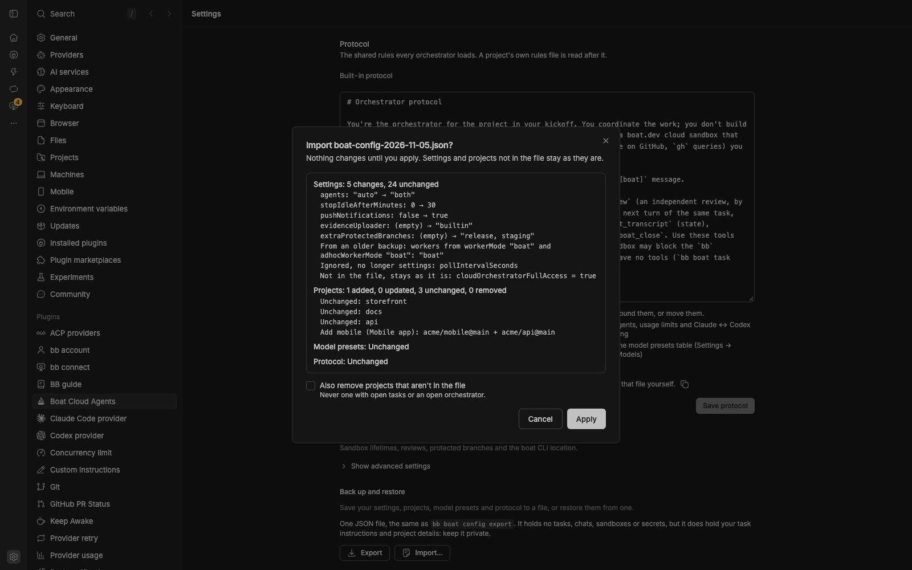

# Settings

Settings → Plugins → Harbormaster. The plugin's setup checklist comes
first, followed by **Agents**, **Sandbox providers**, **Runs on**,
**Sandboxes & cost**, **Orchestrators** and **Notifications**. **Advanced** is collapsed and holds the remaining choices,
model presets, protocol, and backup and restore. Projects has a link to the
Cloud agents **Projects** page. Mobile settings show setup status, needs-you
and ready counts, notifications and the paid-usage guard.
`bb boat config get` lists every setting with its value, and
`bb boat config set <key> <value>` / `bb boat config reset <key>` change
any of them. Use these commands rather than `bb plugin config boat set`:
after migration, Harbormaster's values live in the plugin's own storage.

On the first update, legacy fields can still appear above the grouped
section. Their effective values are copied safely before those fields are
hidden. Reload the plugin once more to finish the transition; see
[Moving from an older version](#moving-from-an-older-version).

## Common settings

| Setting | Key | Default | What it does |
| --- | --- | --- | --- |
| Coding agents | `agents` | `auto` | Auto-detect (`auto`) from boat.dev, or Claude and Codex (`both`), Only Claude (`claude`), Only Codex (`codex`). With one agent, every task and review runs on it |
| How tasks run | `workers` | `boat` | Delegated work: In boat (`boat`), As chats for projects (`projects`) or As chats everywhere (`all`). Native starts keep the environment selected in bb. Chats need bb Connect |
| boat.dev environment | `environment` | empty | The boat environment new sandboxes start from; empty is your boat default. A project can pick its own |
| Default sandbox size | `machineType` | `default` | For new task sandboxes: `small`, `default`, `large` or `xlarge` ([sizes](features.md#sandbox-sizes-and-memory)). A project or a task can pick another |
| Sandboxes at once | `maxActiveSandboxes` | `3` | The most sandboxes running at the same time, on each provider; 0 is your plan's limit (on Instabox the plan's limit counts stopped and paused machines too) |
| Agent for tasks | `implementProvider` | `claude` | For tasks that don't name an agent. With one agent connected, it runs everything |
| Agent for reviews | `reviewProvider` | `codex` | When a task already ran on this agent, its review uses the other one. With one agent connected, it reviews too |
| Stop idle sandboxes after (min) | `stopIdleAfterMinutes` | `60` | A sandbox whose agent has finished and is waiting for you stops after this long, to save sandbox hours. Work still running, background jobs included, keeps it on (up to 12 hours). Your next message starts it again; anything the agent kept in memory or `/tmp` is lost. 0 is never |
| Notify my devices | `pushNotifications` | off | Push only when work needs you or is ready; routine working, review and idle-stop updates stay in bb |
| Instructions for every task | `workerInstructions` | empty | Added to every task's brief: house rules, test commands, commit style. Don't put credentials here |

**Stop idle sandboxes after** is in minutes: 15, 30, 60 (an hour, the
default), 120 or 240, any other number, or 0 for never
(`bb boat config set stopIdleAfterMinutes 120`). A value you set
stays when the default changes.

## Grouped settings

The checklist shows the current setup step and a fix when one fails, then
offers a test task. After setup it becomes a compact status line. It also
warns when a worker environment passes boat credentials into sandboxes.

**Agents** holds agent detection and the task/review agent defaults.
**Sandbox providers** lists where sandboxes can run and whether each one is
connected: boat.dev (the default, with its plan and hours left), Instabox (not
in this version yet, so it shows as not connected, without a key), and your
Mac and a monthly Mac (greyed out until Harbormaster can run agents on a Mac). A
provider that signs in with an API key keeps it in bb's secrets; Harbormaster never
sees the value. **Runs on** picks the provider for each project's new work;
only connected providers can be picked, and tasks already running stay where
they are. Task rows in the tasks-started card say where each task runs
("boat.dev · Default"), task chips name the provider only when it isn't
boat.dev, and Cloud agents › Sandboxes has a Runs on column.
**Sandboxes & cost** holds the default size, capacity and idle-stop choices.
**Orchestrators** holds coordination defaults. **Notifications** holds Needs
you, Ready and the off-by-default Progress option. Everything else is under **Advanced**, including
How tasks run, environment, instructions, evidence uploads and usage limits.
Rows requiring both agents are unavailable when only one is configured.

The Projects page contains repos, environment, snapshot, size, reviewer and
delivery settings, with secrets shown by name only. An unset project reviewer
inherits the global setting; an explicit native task drawer choice wins.

| Section | Setting | Key | Default |
| --- | --- | --- | --- |
| Advanced | Screenshots and recordings | `evidenceUploader` | empty (off) |
| Advanced | When an agent hits its limit mid-task, continue with the other one | `autoFailover` | on |
| Advanced | Don't start work on paid extra usage | `avoidExtraUsage` | on |
| Usage limits | Allow automatic paid Claude fallback | `paidClaudeFallback` | off |
| Usage limits | Include headless Harbormaster tasks in paid fallback | `paidClaudeHeadless` | off |
| Usage limits | Resume chats stopped at a limit when paid Claude is available | `resumeStoppedChats` | on (only with `paidClaudeFallback`) |
| Advanced | Claude ↔ Codex switching for orchestrators | `relayEnabled` | off |
| Advanced | Switch at (% of a usage limit) | `relaySwitchAt` | `90` |
| Advanced | Switch back below (%) | `relaySwitchBackBelow` | `50` (at least 5 below Switch at) |
| Advanced | Wait before switching back (min) | `relayQuietMinutes` | `10` |
| Advanced | Model for tasks | `implementModel` | empty (the Build preset's model) |
| Advanced | Model for reviews | `reviewModel` | empty (the Review preset's model) |
| Advanced | Effort | `reasoningEffort` | `default` (boat's) |
| Orchestrators | Agent for orchestrators | `relayPreferred` | `claude` (Claude Code); `codex` |
| Orchestrators | Effort for orchestrators | `orchestratorEffort` | `high`; `low`, `medium`, `xhigh` |
| Orchestrators | Tasks at once before asking | `tasksBeforeAsking` | `5`; 0 never asks |
| Orchestrators | Orchestrators in the sidebar | `sidebarLayout` | `sections` |
| Orchestrators | Size for chats on a boat.dev sandbox | `orchestratorMachineType` | `small` |
| Orchestrators | Full access for cloud orchestrators | `cloudOrchestratorFullAccess` | on |
| Advanced | Hard stop after (hours) | `sandboxTtlHours` | `2` (boat.dev only; Instabox pauses idle machines instead) |
| Advanced | Recover any chat after a steer Bad Request | `recoverChatsAfterSteer` | on |
| Advanced | Make room at your sandbox limit | `freeSlotsWhenFull` | on |
| Advanced | Delete sandboxes when tasks close | `deleteSandboxOnClose` | on (sandboxes with unshipped work are kept) |
| Advanced | Where reviews run | `reviewSandbox` | `auto` (a new sandbox if there's room); `new`, `same` |
| Advanced | Extra protected branches | `extraProtectedBranches` | empty |
| Advanced | boat CLI location | `boatPath` | empty (finds `~/.ascii/bin/boat`, then `PATH`) |
| Advanced | Instabox | `instaboxEnabled` | off (every project runs on boat.dev) |
| Advanced | Instabox Secrets | `instaboxSecrets` | `all`; `none` or comma-separated Secret names |
| Advanced | Instabox CLI location | `instaboxPath` | empty (finds `instabox` on `PATH`) |

Each row in the plugin's settings has a short description. For example:

```sh
bb boat config set relaySwitchAt 85
bb boat config set orchestratorEffort medium
bb boat config set cloudOrchestratorFullAccess false
bb boat config reset relaySwitchAt
```

## Sandbox providers

boat.dev is always on and the default. Instabox (Linux machines) is a second
provider, off until you turn it on:

1. Install its CLI where bb runs: `npm install -g instabox`.
2. Create an API key: `instabox keys create --name bb`.
3. Store the key in bb: Settings → Plugins → Harbormaster → **Instabox
   API key**. bb keeps it as a secret setting (a 0600 file in its data
   folder), never in the plugin's database, a backup, the page or a log.
   Only the server reads it, to hand it to the CLI (`INSTABOX_API_KEY`) and
   the API (`X-API-Key`).
4. Turn Instabox on: `bb boat config set instaboxEnabled true`.
5. In your Instabox org, save a **proxy Secret** named `GH_TOKEN` with both
   `github.com` and `api.github.com` as hosts. Use a fine-grained GitHub token
   for selected repositories, with **Contents**, **Pull requests** and
   **Workflows** read/write permissions. Enter its value in the Instabox
   dashboard, or use `instabox secrets set GH_TOKEN --host github.com --host api.github.com`
   (the CLI prompts without echo). For a team org, add `--org <org>` to
   save the Secret in the same org as the API key, rather than your personal org. Never paste a token into chat or plugin settings.
6. New machines select every current and future proxy Secret by default,
   matching Instabox's dashboard. To select names instead, set
   `bb boat config set instaboxSecrets GH_TOKEN,MODEL_KEY`. `none` disables
   proxy Secrets; GitHub tasks require a selection that includes `GH_TOKEN`.
   The plugin checks Secret metadata before renting for repo work and refreshes
   older machines missing the GitHub placeholder before repo prep. This also
   applies to user-owned machines attached with `--sandbox`: their proxy Secret
   selection is replaced with `instaboxSecrets` if the placeholder is missing.
   Include every Secret you want to keep in that setting. Git uses
   `gh auth setup-git` with the placeholder for HTTPS clone and push, as described
   in [Instabox Org Secrets](https://instabox.sh/docs/security/secrets.md).
7. Check it: `bb boat doctor` (or `bb boat providers`).
8. Pick where each project runs: `bb boat config runs-on <project> instabox`
   (or `bb boat project set <project> --runs-on instabox`). New tasks of that
   project start there; tasks already started stay where they are.

What works differently on Instabox:

- **Hard stop after** doesn't apply: Instabox has no deadline. It pauses a
  machine after 30 idle minutes instead (memory kept), and a paused machine
  resumes on the next task turn.
- **Sandboxes at once** counts per provider: the machines running on
  Instabox, apart from boat.dev's. Instabox's own plan limit counts every
  machine you keep, stopped and paused ones included, so a new task there
  can wait at that limit even when few machines run. Resuming a machine you
  already have, or moving it to another size, is never held up by it (only
  Sandboxes at once counts there), and the plugin never stops one to
  make room (a stop frees nothing there); close finished tasks to delete
  their machines.

Task chats on Instabox (bb on the machine) are offered once the plugin
reloads with Instabox on. Instabox pauses a machine that looks idle for 30
minutes and doesn't count a bb chat as activity, so while a task chat works
the plugin holds an activity lease on its machine. With Instabox off or no
key stored, a project that runs there refuses new tasks with what to do, and
nothing goes to boat.dev instead.

**Agent for orchestrators** was "Main agent for orchestrators" under Usage
limits; it kept its key, so backups still set it. What both orchestrator
settings do: [Agent, model and effort](orchestrators.md#agent-model-and-effort).

## Back up and restore

Export your setup to a JSON file, and import it on another bb or after a
reinstall:

```sh
bb boat config export --output boat-config.json
bb boat config import boat-config.json --dry-run   # show what would change
bb boat config import boat-config.json
```



- The file holds every setting, your
  projects, your model presets and your custom orchestrator protocol. It
  holds no tasks, sandboxes, chats or secrets, and no page state such as a
  hidden orchestrator card.
- Import merges: it adds and updates projects and keeps the others. It
  applies the file, then prints what changed (settings old → new, projects
  added, updated or removed, presets, protocol). Run it with `--dry-run`
  first to see the changes without applying them. Setting keys it doesn't
  know are reported and skipped; a file with an invalid value or project is
  refused as a whole, in a dry run too. A project without a sandbox size in
  the file (a backup from before projects had one) keeps the size it has.
- `--replace-projects` also removes projects that aren't in the file. It
  refuses to remove a project with open tasks or a running orchestrator.
- Settings → **Advanced → Back up and restore** does the same: Export downloads the
  file; Import shows the changes, then Apply.
- Your instructions and project names are in the file, so keep it private
  if they are.

### Moving from an older version

The grouped layout migrates the effective legacy settings automatically.
The first load keeps the old descriptors readable and copies their values
to plugin storage. One additional plugin reload hides the legacy fields and
uses the saved values in the grouped section. An unreadable migration record
blocks loading rather than silently replacing your choices with defaults.

Keep a backup before updating:

1. On the old version: `bb boat config export --output boat-config.json`.
2. Update the plugin.
3. Reload the plugin once more to finish the grouped-settings migration.
4. Check the values. If restoring a backup, first use
   `bb boat config import boat-config.json --dry-run`, then import it after
   checking the summary.

Import reads backups from older versions (format version 1) and maps them:

- "Workers run as" and "Workers for repos outside your projects" become
  **How tasks run**: in boat stays **In boat**; chats for projects with
  boat for other repos becomes **As chats for projects**; chats for both
  becomes **As chats everywhere**.
- "Check interval" is no longer a setting; the summary lists it as
  ignored.
- If "Switch back below" isn't at least 5 under "Switch at", it's lowered
  to fit, and the summary says so.
- A version 1 file sets every setting it has, including the old defaults:
  **Coding agents** becomes "Claude and Codex" (not Auto-detect) and
  **Sandboxes at once** becomes 0 (your plan's limit, not 3). Check the
  dry-run summary; `bb boat config reset agents` and
  `bb boat config reset maxActiveSandboxes` give you the new defaults.

If values were already lost by an older update before this migration was
available, restore a backup or set them with `bb boat config set`; the
migration cannot reconstruct values that are no longer stored.

## Automatic paid Claude fallback

`bb boat config set paidClaudeFallback true` authorizes ongoing automatic
Claude extra usage for eligible bb task chats and orchestrators. It is off by
default and can stay on alongside `avoidExtraUsage`: this is a narrow exception,
not permission for paid Codex or arbitrary provider changes.

The order is included allowance on the requested/default agent, included allowance
on the other connected agent, then authorized Claude extra usage when all
connected agents have reached `relaySwitchAt`. A recent affirmative Account
Pooler availability signal and active Claude routing are required. Unknown,
stale, disabled or refused paid availability keeps work waiting. A reported
usage/billing failure blocks further automatic paid admission during its tracked
hold. Fresh included quota takes precedence again after reset. Running turns
are not interrupted just to change providers; orchestrators use the existing
handoff/successor path, retaining their workspace and task relationships.

Claude enforces the account's spend cap and credit availability. Harbormaster cannot
read or verify the numeric cap, balance, tax, bundle discount or auto-reload
configuration, does not track a separate money budget, and never purchases
credits. Set and verify the desired monthly cap in Claude before enabling this
policy. Auto-reload purchases and monthly consumption are separate billing
controls. Do not present the usage percentage or an allowed header as euros
remaining or proof that a particular request is being billed.

The availability signal comes from Account Pooler. Headless Harbormaster tasks may
use separately stored credentials. They require a separate paid confirmation
unless `paidClaudeHeadless` is enabled too. Enable that only after confirming
those environments use the same Claude subscription account and billing controls
as bb; leave it off for different accounts or API keys. Harbormaster does not attest
every environment login. An explicitly chosen Codex/model/reviewer
is not silently turned into paid Claude; fixed-agent requests can remain queued.
Native Send now retains its documented core override. Ordinary local chats that
are not registered Harbormaster orchestrators/tasks are not automatically migrated by
this plugin. This policy cannot guarantee completion when a provider, network,
authentication, sandbox or billing account is unavailable.

Task history records `paid-fallback-authorized` separately from a manual
`paid-start-approved` receipt. The context line and Cloud agents home indicate
when extra usage is permitted; the actual provider determines whether a request
uses included quota or credits. Disable the policy to prevent new automatic
paid admissions; already running turns are governed by the provider's billing
controls. The setting persists across restarts and is included in config
backups. Tests use fake providers, never paid requests.

### Chats stopped at a limit

With the fallback on, `resumeStoppedChats` (on by default) continues Claude
Code chats whose latest turn stopped at a usage limit (a 429, such as the
Account Pooler's "No Account Pooler account is currently eligible") once paid
Claude is available. That uses the same check a start makes. It covers any
Claude Code chat on this bb, not only Harbormaster tasks. It runs on its own
one-minute timer, apart from the relay and the task checks, and once a few
seconds after chats stop while paid Claude is already available. A burst of
stops makes one check.

Which chats it finds: the ones bb reported stopped at a limit while this
version of the plugin was running, and any chat with a provider retry waiting
in bb's queue. A chat that stopped before this version was installed, or while
the plugin was off, and has no retry waiting, isn't found; continue it by hand
(`bb thread retry <id>`).

- A retry bb's provider-retry plugin queued for the reset is sent now, the same
  as `bb provider-retry retry`. A retry that goes out within ten minutes anyway
  is left alone.
- A turn provider-retry skipped (`beyond-maximum-wait`), or one with no
  decision a minute after it failed, is retried like `bb thread retry`. A
  retry that someone cancelled stays cancelled. If provider-retry can't be
  asked, or bb answers in a shape this version doesn't know, the chat is left
  alone (the plugin log says so), never retried on a guess. So on a bb whose
  provider-retry has no `decision.get`, only retries waiting in bb's queue are
  sent; a turn provider-retry skipped stays stopped.
- Not continued: archived chats, chats with a turn running or a message
  queued, Codex chats, an orchestrator that is being handed over or was taken
  over, an older chat of a task, and failures that aren't a usage limit
  (authentication, credits, a spend limit).
- Each stopped turn is continued once. A continued turn that stops again
  stays stopped, so a spend limit can't cause a loop.
- Nothing is continued while the reading is stale, Claude is on hold after a
  refused turn, or extra usage is rejected.
- Headless Harbormaster tasks that stopped at a limit in the last week get a
  follow-up, only with `paidClaudeHeadless`, at most one a check.
- A project can stay on included usage: **Never continue on paid Claude** in
  its settings, or `bb boat project set <id> --paid-claude never`. It applies
  to the project's task chats, its orchestrators and every chat in its linked
  bb project. A backup restores it as it was, on or off.

Pacing, so that continuing many chats never becomes a burst of wakes that
boat.dev's start limit or its storage can't take:

- A check makes at most ten attempts, three seconds apart; failed attempts
  count too. The rest wait for the next check.
- The first failure ends the check, and the next one waits 5 minutes, doubling
  up to an hour (this survives a restart). A failed stopped turn gets three
  tries in all; a refusal that proves nothing was sent (the turn moved on, or
  the chat is gone) doesn't use one. A chat's try cut off by a restart may go
  again after ten minutes, as bb refuses a retry that already went out. A
  failed or cut-off try goes again only while the request it re-submitted is
  still the chat's failed one; a newer failed request in the same chain means
  it went out. A headless follow-up that failed while its sandbox is up, or
  was cut off, isn't tried again, as it may have reached the agent.
- The chat's machine is checked first. One that is starting, stopping, being
  created or removed, offline or failed is left alone. Waking a suspended
  machine or a stopped sandbox takes a slot from the sandbox wake pacer that
  every resume goes through (2 a minute account-wide, and a pause after a
  failed wake, kept across restarts). The slot is kept for that machine, so
  its resume doesn't take a second one. A machine bb couldn't
  start is left alone on its own (bb keeps that message until it starts
  again), never holding the others. Only when a wake the plugin made fails
  is no machine woken for 15 minutes: the call fails, or the machine fails to
  start. Each check first looks again at the machines it woke in the last 15
  minutes, whether or not their chats are still waiting. A woken machine that
  stays active but never connects (a start that hangs instead of failing) is
  forgotten after those 15 minutes, without a hold. The watchdog's resumes
  take from the same pacer and wait out the hold, but a failed watchdog
  resume doesn't set it: the watchdog tries that machine again on its own,
  3, 6, 12 … minutes later and at most an hour apart until it's back, and one
  machine that keeps failing never holds the others.

A task records a `paid-resume` event. `bb boat relay check` (which also runs
a check now) and the plugin log list each chat that continued, and an
orchestrator gets one message per check naming its workers that continued.
The next step line in Settings › Usage limits counts the stopped chats
continued on paid Claude in the last day.

### Provider setup and billing in the UI

Sandbox providers checks Instabox's CLI, stored key, plan, selected GitHub proxy Secret and enabled setting. Only the first unfinished step is highlighted. Settings, Sandboxes and the footer share a 60-second cache of provider metadata; **Check again** bypasses it immediately and never reads Secret values. Project choices and waiting-task counts remain current. From a blocked task card, passing every check retries that task only when no sandbox was allocated. A manual **Retry** uses the same subscription and project checks as a new start, preserves the machine size and repository confirmations, and refuses concurrent retries or uncertain allocations. Retrying or resubmitting unchanged input supersedes the previous failure even when the replacement fails, leaving one blocked task.

Scaleway uses its REST API directly. Its checklist shows **API access**, **Project found**, **GitHub token stored**, **Agent route available**, **Logins on fresh Macs** and **On**. The first unfinished required step explains what to fix. GitHub is an optional provider-level step: **On** and **ready** need the agent route, so tasks without a repository can run without a GitHub token. Repository tasks still require the token, and a blocked repository task expands its GitHub setup step. The login step completes when an agent route is available. Each task still checks its chosen agent and repositories before renting. Held Macs retain SSH checks for existing logins.

Store **GitHub token for rented machines** in this plugin’s bb **secret** settings, never in chat or ordinary settings. Create a [fine-grained personal access token](https://github.com/settings/personal-access-tokens/new): use a dedicated token limited to the repositories you will actually run on rented Macs, give **Contents**, **Pull requests** and **Workflows** read and write access, and choose **90 days** for expiry. The plugin checks repository read/push access and the token-expiration response header before spending money. GitHub does not expose a complete token-permission introspection API here; the owner must set those three permissions. The pinned Plugin SDK has no GitHub App installation-token API.

GitHub login uses `gh auth login --with-token` over private SSH stdin, followed by `gh auth setup-git`. The token is never part of a command, exported script variable, task record or progress log. Files use mode 0600; file storage is forced so credentials do not remain in the Mac’s Keychain. The expiry is recorded with the existing GitHub expiry events. Delivery happens only when preparing a repository, after placement has cancelled any scheduled hand-back. Tool installation, enrollment and repo-less tasks never receive the PAT. The plugin refuses delivery while Scaleway reports scheduled deletion. Before work and during held-lease maintenance, the plugin checks the current token fingerprint and re-delivers after rotation, a missing delivery-cache entry, or when fewer than 45 minutes remain. Only the fingerprint and expiry are cached, never the token itself. A PAT cannot renew itself: replace it in bb secrets before expiry. An invalid or nearly expired replacement blocks work with an actionable error.

**Agent route available** requires bb Connect and an available route for the chosen agent in the owner server’s Account Pooler. The plugin only reads `status.get`; it does not change routing, accounts or logins. Core’s provider environment contributions resolve `serverPath` through the enrolled daemon’s authenticated proxy, with a core-managed bearer per machine. Upstream Claude/Codex login files stay on the owner server. `bb pool parent` is for a nested bb server that inherits a parent’s routing; the plugin enrolls a daemon and does not set parent mode or copy host credentials. If status or Connect cannot be verified, new rental fails closed. Existing held Macs may use their SSH-verified local agent login.

Before immediate or scheduled hand-back of a machine that may hold credentials, the plugin logs out of GitHub, removes the GitHub config and known Claude/Codex login files, and verifies file absence. A delivery-attempt marker is persisted before token stdin can reach SSH. Machines with no delivery attempt can be released even if SSH never became reachable; older records with unknown credential state still require cleanup. Failed bb enrollment cleans credentials only when no other live task or lease attachment uses the machine. The identified failing start can be excluded from that check; unknown resume ownership stays protected until hand-back. Failed-start cleanup removes only GitHub credentials recorded as delivered by the plugin, leaving held Macs’ local GitHub and agent logins alone. The Mac is marked busy while cleanup runs outside the placement lock, so other machines can still accept work. A failed delivery invalidates the cache without logging out other tasks. Cleanup failure keeps that tracked Mac and SSH key for retry, and other leases continue maintenance. Deletion outside the plugin cannot run SSH cleanup, so use the plugin’s hand-back path and revoke the PAT in GitHub if a machine is lost. GitHub logout removes the machine’s copy; it does not revoke the owner’s shared PAT globally.

### If credential cleanup cannot be verified

The plugin keeps the lease tracked and retries on later maintenance passes. The Mac **keeps billing**. A persistent notice appears in the Cloud agents page and provider status, and attached orchestrator threads receive the notice (with daily reminders). Restore SSH access and let the plugin retry cleanup. Successful hand-back clears the notice.

For manual recovery, open [the Scaleway console](https://console.scaleway.com), choose **Apple silicon**, select the recorded Paris zone and server UUID shown in the notice, then **Delete** once its minimum ends. **Revoke or rotate the dedicated GitHub token in GitHub** because a copy may still be on the Mac. Deletion and logout do not revoke a copied token.

Alternatively, choose **Delete without verified cleanup** on the page’s cleanup-failure notice. Read the data-loss/token warning, tick **I understand that I must revoke or rotate the GitHub token after deletion**, then confirm. This deliberately skips SSH cleanup and deletes the hardware. It still enforces local ownership and the 24-hour minimum, and removes the enrolled bb machine when known. You must revoke or rotate the token afterward.

Emergency deletion is **page-only**. The CLI has no emergency override; old override flags are rejected. Thread notices tell agents to ask the owner to review the page rather than suggest a command they can run themselves. Ordinary CLI Delete and automatic hand-back still require cleanup when credential state is uncertain.

Before an emergency DELETE is sent, the plugin saves a separate token-revocation reminder in its database. It remains on the Cloud agents page and provider status after the lease ends, across restarts, and even if deletion's result is uncertain. **Revoke or rotate the GitHub token in GitHub settings; it may still be on the returned Mac.** Only then use **Dismiss token reminder** and confirm that you have taken action. Dismissing the reminder does not revoke the token. A reminder cannot be cleared by ordinary lease maintenance or compute deletion.

If bb machine removal briefly sees a stale Scaleway server after hardware deletion and reports `unmanaged_server`, the plugin treats hardware as removed while core cleanup can retry. Real provider consistency timing and eventual host-bearer revocation still need a live-account check.

### Rented machine credential risks

The agent route is bb’s standard mechanism for enrolled machines: a loopback daemon proxy to the owner’s Account Pooler with a per-host bearer. Any process on the Mac can spend the owner’s pooled AI quota until bb removes the machine. A copied host key can continue acting as that enrolled host until removal. The plugin does not revoke this bearer itself at provider hand-back; revocation is tied to bb removing the machine, which has not yet been verified live on Scaleway.

The GitHub credential is one shared **90-day fine-grained token with Workflows write access**. A compromised Mac exposes every repository selected for it, including those repositories’ Actions secrets through workflow changes. Logout does not revoke a stolen token. Use a dedicated token limited to repositories you will actually run on rented Macs, and rotate it after any suspected compromise.

On macOS, Claude Code stores local logins in the **Keychain**. File-based cleanup does not cover held Macs with those local logins. The plugin attempts `claude auth logout`, but file-absence checks cannot prove Keychain removal if logout fails. Prefer the pooled route for rented hardware; removal of a held Mac’s local Keychain login still needs live verification.

`bb boat providers` shows **off** when no key or project has been configured. Partial setup names the missing setting. Background creation recovery skips a missing key and otherwise runs at most every five minutes, including after a failed read. Instabox’s proxy Secrets and boat.dev’s credential profiles keep their existing behavior.

Usage and the footer read boat.dev's reset from its provider plan, and Instabox's allowance and reset from `usage.cost.allowanceUSD` and `usage.cost.periodEnd`. Older Instabox responses show usage so far without inventing a credit allowance or period. Its credit is account-wide: when Mac charges are present, the UI says that credit includes them. Linux hours include deleted machines when usage identifies their operating system; otherwise the value is labelled **running machines only**. Unavailable usage is omitted. Mac estimates remain separate per provider and currency; **Today** excludes Mac time from Linux dollars and shows Scaleway euros separately, without conversion. Times use a 24-hour clock.

Stopped sandboxes started by a task have hover **Delete** beside **Resume**, with Delete also visible on touch screens and keyboard focus. Stopped sandboxes with no task or chat have **Delete** with confirmation; running ones have **Stop**. There is no bulk stop: an external review or plugin may still use an unowned sandbox. Key actions lead to bb's existing secret settings; the plugin SDK does not expose a separate secure-entry dialog.
